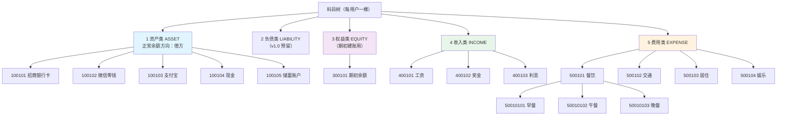

# 数据库设计

> 配套文档：[系统设计说明书.md](./系统设计说明书.md)
> 本文档中的表结构、索引与 DDL 即为实现依据。任何字段变更必须先修订本文档，再通过 Flyway 迁移脚本落地。

## 1. 设计约定

| 项 | 约定 |
| --- | --- |
| 引擎 / 字符集 | InnoDB / `utf8mb4` + `utf8mb4_0900_ai_ci` |
| 命名 | 表名、字段名一律 `snake_case`，表名用单数（`subject` 而非 `subjects`） |
| 主键 | `BIGINT UNSIGNED AUTO_INCREMENT`，字段名统一 `id` |
| 金额 | `DECIMAL(18,2)`，**禁止 `FLOAT` / `DOUBLE`**（理由见说明书 §7.1） |
| 日期 | 记账日期用 `DATE`（不含时间）；审计时间戳用 `DATETIME(3)` |
| 时间戳 | `created_at` 默认 `CURRENT_TIMESTAMP(3)`；`updated_at` 带 `ON UPDATE` |
| 软删除 | 仅 `sys_user`、`subject`、`budget` 使用 `deleted TINYINT(1) DEFAULT 0`；**`ledger` 与 `entry` 永不删除**（账务 append-only） |
| 布尔 | `TINYINT(1)`，0 = 否，1 = 是 |
| 枚举 | 用 `VARCHAR(20)` 存枚举名字符串（可读性优先于空间），取值受 Java 枚举约束，不用 `TINYINT` 编码 |
| 外键 | **不使用物理外键约束**，由应用层保证引用完整性。理由：账务表写入频繁，物理外键会增加锁竞争；且项目需要支持数据迁移与分表演进 |
| 注释 | 每张表、每个字段必须有 `COMMENT`，便于 Navicat / DataGrip 直接查看语义 |

### 1.1 枚举取值速查

| 枚举 | 取值 | 说明 |
| --- | --- | --- |
| `subject.subject_type` | `ASSET` / `LIABILITY` / `EQUITY` / `INCOME` / `EXPENSE` | 五类会计科目 |
| `account_meta.account_kind` | `BANK` / `WECHAT` / `ALIPAY` / `CASH` / `SAVING` / `INVEST` / `OTHER` | 账户子类型，仅用于图标与筛选 |
| `ledger.ledger_type` | `EXPENSE` / `INCOME` / `TRANSFER` / `OPENING` / `REVERSAL` | 凭证类型 |
| `ledger.state` | `CREATED` / `POSTED` / `PARTIALLY_REVERSED` / `REVERSED` | 凭证状态机，见说明书 §5.1.4 |
| `entry.direction` | `DEBIT` / `CREDIT` | 借方 / 贷方 |
| `budget.period_type` | `WEEK` / `MONTH` / `CUSTOM` | 预算周期类型 |
| `budget.scope_type` | `TOTAL` / `SUBJECT` | 总预算 / 分类预算 |
| `budget.rollover_mode` | `NONE` / `SURPLUS_ONLY` / `FULL` | 无结转 / 仅结余结转 / 完整结转（含超支），见说明书 §7.5.3 |
| `budget_period.settle_state` | `OPEN` / `SETTLED` | 进行中 / 已结算 |
| `budget_alert.alert_level` | `INFO` / `WARNING` / `DANGER` | 提醒 / 预警 / 超支 |

---

## 2. 会计数据模型核心设计

### 2.1 为什么资金账户与消费分类必须合成一张表

这是整个数据库设计中最关键的一个决策，也是原《简易设计说明书》最需要修正的地方。

复式记账的硬约束是：**每笔业务至少两条分录，借方合计 = 贷方合计**。要让这个约束成立，分录的两个方向必须能用**同一套分类体系**来表达：

| 业务 | 借方 | 贷方 | 若拆成两套体系会怎样 |
| --- | --- | --- | --- |
| 买午餐 30 元 | 费用 / 餐饮 / 午餐 | 资产 / 支付宝 | 贷方能填"支付宝"，**借方"餐饮"无处安放** |
| 发工资 8000 元 | 资产 / 银行卡 | 收入 / 工资 | **贷方"工资"无处安放** |
| 转账 500 元 | 资产 / 支付宝 | 资产 / 银行卡 | 恰好可行（两边都是账户）→ 这就是原方案唯一能跑通的场景 |

可见原方案把 `account` 与 `category` 拆开，只能支持"转账"，支出和收入分录根本配不平。**因此合并为统一的 `subject` 表**：



### 2.2 余额的一致性策略

| 数据 | 角色 | 说明 |
| --- | --- | --- |
| `entry.signed_amount` 之和 | **唯一真相（Source of Truth）** | 任何余额都能由分录重算得出 |
| `account_meta.balance` | 缓存 | 记账/冲正在同一事务内原子更新，避免每次查询都做全表聚合 |
| `budget_period.used_amount` | 缓存 | 同上，避免预算列表页 N 次聚合查询 |
| `reconcile_log` | 对账凭证 | 每日定时校验缓存与真相是否一致，不一致则告警并重算 |

**为什么敢用缓存？** 因为有两个保障：一是所有写路径都在同一事务内更新缓存；二是每日对账任务能发现并修复任何漂移。纯实时聚合（不用缓存）会导致预算列表页每次刷新都要扫描全部历史分录，性能不可接受。

### 2.3 三处刻意设计的"冗余"

| 冗余字段 | 为什么保留 |
| --- | --- |
| `subject.path` | 子树查询用 `path LIKE '/1/12/%'`，避免递归 CTE。新增时由父节点 path + 自身 id 拼出，移动子树时批量更新前缀 |
| `entry.signed_amount` | 让"科目余额 = `SUM(signed_amount)`"，无需在每条 SQL 里写 `CASE WHEN direction`；冲正自动抵消（说明书 §7.3.3） |
| `ledger.occurred_date` | 统计 SQL 的主要过滤条件，冗余后 `entry` 与 `ledger` 的 JOIN 可用覆盖索引，避免三表关联 |

---

## 3. 表结构详细设计

### 3.1 sys_user —— 用户表

| 字段 | 类型 | 约束 | 说明 |
| --- | --- | --- | --- |
| `id` | BIGINT UNSIGNED | PK, AUTO_INCREMENT | 用户 ID |
| `email` | VARCHAR(128) | NOT NULL, UNIQUE | 登录邮箱，存小写 |
| `password_hash` | VARCHAR(100) | NOT NULL | BCrypt 哈希（强度 10），不存明文 |
| `nickname` | VARCHAR(50) | NOT NULL | 昵称 |
| `avatar_url` | VARCHAR(512) | NULL | 头像地址 |
| `status` | VARCHAR(20) | NOT NULL, DEFAULT 'ACTIVE' | `ACTIVE` / `DISABLED` |
| `email_verified` | TINYINT(1) | NOT NULL, DEFAULT 0 | 邮箱是否已验证 |
| `last_login_at` | DATETIME(3) | NULL | 最近登录时间 |
| `created_at` | DATETIME(3) | NOT NULL | 创建时间 |
| `updated_at` | DATETIME(3) | NOT NULL | 更新时间 |
| `deleted` | TINYINT(1) | NOT NULL, DEFAULT 0 | 逻辑删除；置 1 时同时改写 email 释放唯一约束 |

**索引**

| 名称 | 字段 | 类型 | 用途 |
| --- | --- | --- | --- |
| `uk_email` | `email` | UNIQUE | 登录查询、注册查重 |

> **逻辑删除与唯一约束的冲突：** 用户注销后 `deleted = 1`，但 `email` 仍占用唯一索引。处理方式：注销时将 `email` 改写为 `原邮箱#deleted#<用户id>`，原始邮箱记入 `user_profile.remark` 或单独的注销审计表。**不要**使用 MySQL 8 的函数索引 `UNIQUE((CASE WHEN deleted=0 THEN email END))`——虽然可行，但可读性差且 ORM 兼容性不佳。

---

### 3.2 user_profile —— 用户偏好设置

与 `sys_user` 一对一，把"高频查询的账号字段"与"低频变更的偏好字段"分离，避免每次查用户都要读一堆配置列。

| 字段 | 类型 | 约束 | 说明 |
| --- | --- | --- | --- |
| `id` | BIGINT UNSIGNED | PK | 主键 |
| `user_id` | BIGINT UNSIGNED | NOT NULL, UNIQUE | 关联 `sys_user.id` |
| `base_currency` | VARCHAR(8) | NOT NULL, DEFAULT 'CNY' | 本位币，v1.0 固定 CNY |
| `currency_symbol` | VARCHAR(8) | NOT NULL, DEFAULT '¥' | 展示符号 |
| `amount_precision` | TINYINT | NOT NULL, DEFAULT 2 | 展示小数位 |
| `week_start` | TINYINT | NOT NULL, DEFAULT 1 | 周起始日：1 = 周一，7 = 周日。**周预算与周报表口径依赖此值**（说明书 §7.5.1） |
| `strict_balance_mode` | TINYINT(1) | NOT NULL, DEFAULT 0 | 严格余额模式：1 = 余额不足时拒绝支出/转账（说明书 UC-08 异常流） |
| `budget_warn_threshold` | DECIMAL(5,2) | NOT NULL, DEFAULT 80.00 | 预算预警阈值（百分比） |
| `alert_email_enabled` | TINYINT(1) | NOT NULL, DEFAULT 1 | 是否邮件推送超支预警 |
| `preferences` | JSON | NULL | 扩展偏好（主题、默认账本科目、图表默认粒度），后加字段无需改表 |
| `created_at` | DATETIME(3) | NOT NULL | — |
| `updated_at` | DATETIME(3) | NOT NULL | — |

**索引：** `uk_user_id (user_id)` UNIQUE

> `week_start` 放在这里而不是常量，是因为"周预算从周几开始"直接影响所有周维度的统计结果。若硬编码为周一，用户看到的"本周支出"会与其直觉不符。**这是一个容易被忽略但用户一定会感知的口径问题。**

---

### 3.3 subject —— 会计科目表（核心）

**全库最重要的一张表。** 资金账户与消费分类都是它的行，靠 `subject_type` 区分。

| 字段 | 类型 | 约束 | 说明 |
| --- | --- | --- | --- |
| `id` | BIGINT UNSIGNED | PK | 科目 ID，也是分录中引用的 `subject_id` |
| `user_id` | BIGINT UNSIGNED | NOT NULL | 所属用户（每用户一棵独立科目树） |
| `parent_id` | BIGINT UNSIGNED | NOT NULL, DEFAULT 0 | 父科目 ID，0 表示一级科目 |
| `name` | VARCHAR(64) | NOT NULL | 科目名称，如"午餐""招商银行卡" |
| `subject_code` | VARCHAR(32) | NOT NULL | 科目编码，如 `50010102`，同用户内唯一 |
| `subject_type` | VARCHAR(20) | NOT NULL | `ASSET` / `LIABILITY` / `EQUITY` / `INCOME` / `EXPENSE` |
| `normal_side` | VARCHAR(10) | NOT NULL | 正常余额方向：`DEBIT` / `CREDIT`。由 `subject_type` 决定，冗余存储便于校验与直读 |
| `level` | TINYINT UNSIGNED | NOT NULL | 层级，从 1 开始。冗余存储，避免统计时反复计算 `path` 深度 |
| `path` | VARCHAR(255) | NOT NULL | 物化路径，格式 `/1/12/125/`（含自身 id，前后均有 `/`） |
| `is_leaf` | TINYINT(1) | NOT NULL, DEFAULT 1 | 是否叶子。**只有叶子可记账（BR-10）**。新增子科目时把父节点置 0 |
| `budgetable` | TINYINT(1) | NOT NULL, DEFAULT 0 | 是否可作为预算范围，仅费用类为 1 |
| `icon` | VARCHAR(64) | NULL | 图标名 |
| `color` | VARCHAR(16) | NULL | 展示颜色，如 `#FF7043` |
| `sort_order` | INT | NOT NULL, DEFAULT 0 | 同级排序 |
| `enabled` | TINYINT(1) | NOT NULL, DEFAULT 1 | 是否启用。停用后不出现在记账下拉框，但历史分录仍可查询 |
| `remark` | VARCHAR(255) | NULL | 备注 |
| `created_at` | DATETIME(3) | NOT NULL | — |
| `updated_at` | DATETIME(3) | NOT NULL | — |
| `deleted` | TINYINT(1) | NOT NULL, DEFAULT 0 | 逻辑删除。**存在分录引用时禁止删除（FR-A-04），只允许 `enabled = 0`** |

**索引**

| 名称 | 字段 | 类型 | 用途 |
| --- | --- | --- | --- |
| `uk_user_code` | `user_id`, `subject_code` | UNIQUE | 编码唯一 |
| `idx_user_type` | `user_id`, `subject_type`, `deleted` | 普通 | 按类型取科目（记账下拉框、分析筛选） |
| `idx_parent` | `user_id`, `parent_id` | 普通 | 构建科目树 |
| `idx_path` | `path`(前缀 64) | 普通 | **子树查询 `path LIKE '/1/12/%'`**，预算与分析的性能命脉 |
| `idx_user_leaf` | `user_id`, `is_leaf`, `enabled` | 普通 | 记账时校验科目可用性 |

**设计说明**

1. **`path` 的维护规则**
   - 新增一级科目：先插入得 `id`，再 `path = CONCAT('/', id, '/')`
   - 新增子科目：`path = CONCAT(parent.path, newId, '/')`，同时 `parent.is_leaf = 0`
   - 移动子树：`UPDATE subject SET path = REPLACE(path, oldPrefix, newPrefix), level = level + Δ WHERE path LIKE oldPrefix || '%'`
   - **`path` 必须以 `/` 开头和结尾**，才能保证 `LIKE '/1/12/%'` 不会误匹配 `/1/120/`。这是经典的前缀匹配陷阱。

2. **`subject_code` 的生成规则**

   一级科目由类型前缀 `1`–`5` 加 2 位序号构成，二级及以下为「父编码 + 2 位序号」：

   | 层级 | 规则 | 示例 |
   | --- | --- | --- |
   | 一级 | `{类型前缀}{2位序号}` | `5001` 费用·餐饮（容器） |
   | 二级 | `一级编码{2位序号}` | `500101` 费用·餐饮·早餐 |
   | 三级 | `二级编码{2位序号}` | `50010101` 更细的子类 |
   | 用户自定义 | 同层级规则，序号取该父节点下最大值 + 1 | `500110` |

   编码仅用于**展示与排序**，不承载任何业务语义。**业务逻辑一律用 `id` 关联、用 `path` 与 `level` 做层级处理**——这样用户手工改编码不会破坏任何数据。

   > **不要用编码来推导层级。** 用户完全可以把某个科目编码改成任意值；层级关系只由 `parent_id` / `path` / `level` 三者表达，其中 `parent_id` 是唯一权威来源。

3. **为什么把 `normal_side` 冗余存下来？** 它完全可由 `subject_type` 推导，但冗余后可以在 SQL 层直接按方向聚合，也便于在数据异常时（如手工改库）快速发现不一致。属于"小冗余、大方便"。

---

### 3.4 account_meta —— 资金账户扩展表

仅 `subject_type = ASSET` 的行有对应记录，存放账户特有的属性与余额缓存。

| 字段 | 类型 | 约束 | 说明 |
| --- | --- | --- | --- |
| `id` | BIGINT UNSIGNED | PK | 主键 |
| `subject_id` | BIGINT UNSIGNED | NOT NULL, UNIQUE | 关联 `subject.id`（资产类科目） |
| `user_id` | BIGINT UNSIGNED | NOT NULL | 冗余用户 ID，便于直接按用户查全部账户 |
| `account_kind` | VARCHAR(20) | NOT NULL, DEFAULT 'OTHER' | `BANK` / `WECHAT` / `ALIPAY` / `CASH` / `SAVING` / `INVEST` / `OTHER` |
| `bank_name` | VARCHAR(64) | NULL | 开户行，仅银行卡 |
| `card_tail_no` | VARCHAR(8) | NULL | 卡号后四位，**禁止存完整卡号** |
| `opening_balance` | DECIMAL(18,2) | NOT NULL, DEFAULT 0.00 | 期初余额 |
| `balance` | DECIMAL(18,2) | NOT NULL, DEFAULT 0.00 | **当前余额缓存**（= 期初 + Σ signed_amount）。允许为负（透支/信用卡） |
| `include_in_net_worth` | TINYINT(1) | NOT NULL, DEFAULT 1 | 是否计入净资产统计 |
| `reconciled_at` | DATETIME(3) | NULL | 最近一次对账通过时间 |
| `created_at` | DATETIME(3) | NOT NULL | — |
| `updated_at` | DATETIME(3) | NOT NULL | — |

**索引**

| 名称 | 字段 | 类型 | 用途 |
| --- | --- | --- | --- |
| `uk_subject` | `subject_id` | UNIQUE | 一对一 |
| `idx_user` | `user_id` | 普通 | 账户列表 |

**为什么余额缓存放在扩展表而不是 `subject`？**
`subject` 表会被科目树接口整表读取，把余额塞进去会让科目树查询带上不必要的重字段；而且 `account_meta` 只在资产科目上才有行，分开后语义更干净。

---

### 3.5 ledger —— 记账凭证表

一笔业务一条记录。**该表只插入和更新状态字段，永不删除。**

| 字段 | 类型 | 约束 | 说明 |
| --- | --- | --- | --- |
| `id` | BIGINT UNSIGNED | PK | 凭证 ID |
| `ledger_no` | VARCHAR(32) | NOT NULL | 凭证号，格式 `LE + yyyyMMdd + 3 位当日流水`，如 `LE20250301001` |
| `user_id` | BIGINT UNSIGNED | NOT NULL | 所属用户 |
| `ledger_type` | VARCHAR(20) | NOT NULL | `EXPENSE` / `INCOME` / `TRANSFER` / `OPENING` / `REVERSAL` |
| `state` | VARCHAR(24) | NOT NULL, DEFAULT 'CREATED' | `CREATED` / `POSTED` / `PARTIALLY_REVERSED` / `REVERSED` |
| `amount` | DECIMAL(18,2) | NOT NULL | 凭证金额（借方合计 = 贷方合计） |
| `reversed_amount` | DECIMAL(18,2) | NOT NULL, DEFAULT 0.00 | 已冲正金额，累计值 |
| `reversal_of_id` | BIGINT UNSIGNED | NULL | 冲正单指向的原凭证 ID；非冲正单为 NULL |
| `occurred_date` | DATE | NOT NULL | **记账业务日期**（冗余自业务字段，统计主过滤条件） |
| `occurred_at` | DATETIME(3) | NULL | 精确发生时间（可选，用户填写时保留） |
| `remark` | VARCHAR(255) | NULL | 备注 |
| `reversal_reason` | VARCHAR(255) | NULL | 冲正原因（仅冲正单） |
| `idempotency_key` | VARCHAR(64) | NULL | 幂等键，客户端 UUID |
| `request_id` | VARCHAR(64) | NULL | 请求追踪 ID，关联日志 |
| `created_at` | DATETIME(3) | NOT NULL | 创建时间 |
| `posted_at` | DATETIME(3) | NULL | 记账生效时间 |

**索引**

| 名称 | 字段 | 类型 | 用途 |
| --- | --- | --- | --- |
| `uk_user_no` | `user_id`, `ledger_no` | UNIQUE | 凭证号唯一 |
| `uk_idem` | `user_id`, `idempotency_key` | UNIQUE | **幂等第三层防护**（说明书 §7.7.3）。MySQL 唯一索引允许多个 NULL，因此未传幂等键的历史数据不受影响 |
| ~~`uk_reversal_once`~~ | `reversal_of_id`, `ledger_type` | ~~UNIQUE~~ **已删除** | **V3 迁移已删除此索引**。原意是限制一张单据只能被"全额冲正"一次，但它与"部分冲正"的设计直接冲突：部分冲正会产生多条 `reversal_of_id` 相同的 REVERSAL 凭证，唯一索引会把第二次之后的部分冲正全部拒绝（实测报 `Duplicate entry`）。真正防止重复冲正的是行锁 + `isReversible()` 状态校验，索引并非必需 |
| `idx_user_date` | `user_id`, `occurred_date`, `state` | 普通 | 账目分页查询、期间聚合 |
| `idx_user_type_date` | `user_id`, `ledger_type`, `occurred_date` | 普通 | 按类型筛选 |

**设计说明**

1. **`occurred_date` 用 `DATE` 而非 `DATETIME`。** 若用 `DATETIME` 且以 UTC 存储，"3 月 1 日 00:30 记的账"在东八区读出来会变成 2 月 28 日，导致月度统计错位。用 `DATE` 直接消除时区歧义（说明书 §7.6.1）。

2. **`amount` 与 `reversed_amount` 的约束。** 应用层强制 `0 < reversed_amount ≤ amount`。可选的数据库级保障：

   ```sql
   ALTER TABLE ledger
     ADD CONSTRAINT ck_ledger_amount CHECK (amount > 0),
     ADD CONSTRAINT ck_ledger_reversed CHECK (reversed_amount >= 0 AND reversed_amount <= amount);
   ```

   MySQL 8.0.16+ 才真正执行 CHECK 约束，加之前需确认版本。

3. **`state` 与 `reversed_amount` 的对应关系（不能在代码里各写各的）**

   | 条件 | `state` |
   | --- | --- |
   | `reversed_amount = 0` | `POSTED` |
   | `0 < reversed_amount < amount` | `PARTIALLY_REVERSED` |
   | `reversed_amount = amount` | `REVERSED` |

   建议在 `ledger` 表上建一个生成列或由 Service 层统一封装 `resolveState(amount, reversedAmount)`，**禁止在多个地方各写一套 if-else**。

4. **冲正单的 `amount` 等于冲正金额本身，而非原凭证金额。** 部分冲正时，冲正单 `amount = 33.33`，其 `reversal_of_id` 指向原凭证。

5. **`ledger_no` 的生成方式（并发下容易出错，必须明确）**

   格式为 `LE + yyyyMMdd + 3 位当日流水`。流水号**不能**用 `SELECT COUNT(*) + 1` 生成——两个并发请求会算出同一个号，虽有 `uk_user_no` 兜底不致脏数据，但会表现为随机失败。

   推荐做法：用一张轻量的序列表按月/日分配，或直接采用 `LE + yyyyMMdd + 用户ID后4位 + 当日毫秒级时间戳后3位` 的组合以保证唯一。**最简方案：把 `ledger_no` 当作纯展示字段，用 `id` 生成（如 `LE20250301` + `LPAD(id % 1000, 3, '0')`），唯一性由 `id` 保证。** 个人记账场景下凭证号不需要严格连续，可读与唯一即可。

---

### 3.6 entry —— 会计分录表（账务唯一真相）

**全库的数据核心。只插入，永不更新、永不删除。**

| 字段 | 类型 | 约束 | 说明 |
| --- | --- | --- | --- |
| `id` | BIGINT UNSIGNED | PK | 分录 ID |
| `ledger_id` | BIGINT UNSIGNED | NOT NULL | 所属凭证。**存在分录的凭证不可删除（应用层禁止物理删除）** |
| `entry_no` | TINYINT UNSIGNED | NOT NULL | 凭证内序号，从 1 开始，便于阅读顺序 |
| `subject_id` | BIGINT UNSIGNED | NOT NULL | 科目 ID（必须是叶子科目） |
| `direction` | VARCHAR(10) | NOT NULL | `DEBIT`（借）/ `CREDIT`（贷） |
| `amount` | DECIMAL(18,2) | NOT NULL | 金额，**恒为正数**（方向由 `direction` 表达） |
| `signed_amount` | DECIMAL(18,2) | NOT NULL | 带符号金额：借为 `+amount`，贷为 `-amount`。**冗余字段，是余额与统计聚合的核心** |
| `summary` | VARCHAR(255) | NULL | 分录摘要 |
| `created_at` | DATETIME(3) | NOT NULL | 创建时间 |

**索引**

| 名称 | 字段 | 类型 | 用途 |
| --- | --- | --- | --- |
| `idx_ledger` | `ledger_id`, `entry_no` | 普通 | 凭证详情（顺序读两条分录） |
| `idx_subject` | `subject_id`, `id` | 普通 | 科目流水、科目余额重算（`idx_subject` 让 `SUM(signed_amount) GROUP BY subject_id` 走索引） |
| `idx_ledger_subject` | `ledger_id`, `subject_id` | 普通 | 按凭证+科目定位分录（冲正时用） |

**设计说明**

1. **为什么 `amount` 恒为正、方向单独存？**
   负数金额会让"金额"与"方向"产生语义重叠（−30 的借方到底是什么意思？），阅读和校验都容易出错。恒正 + 方向是最不容易误用的表达（说明书 §7.1）。

2. **`signed_amount` 是性能与正确性的双重关键。**

   ```sql
   -- 科目余额：无需 CASE WHEN，且冲正自动抵消
   SELECT COALESCE(SUM(signed_amount), 0) FROM entry WHERE subject_id = ?;

   -- 期间费用额（预算已用额、消费分析）：冲正天然抵消，无需额外排除逻辑
   SELECT COALESCE(SUM(e.signed_amount), 0)
   FROM entry e JOIN ledger l ON l.id = e.ledger_id
   WHERE l.user_id = ? AND l.occurred_date BETWEEN ? AND ?
     AND e.subject_id IN (/* 费用类叶子科目 */);
   ```

   如果不用 `signed_amount`，每条聚合 SQL 都要写 `SUM(CASE WHEN direction='DEBIT' THEN amount ELSE -amount END)`，不仅冗长，而且**一旦某处漏写符号，统计结果就会静默出错**。冗余一个字段换取全库聚合逻辑的统一，非常划算。

3. **不加 `user_id` 冗余。** 曾考虑在 `entry` 上冗余 `user_id` 以省掉 JOIN，但 `entry` 是全库最大的表，多一个 BIGINT 字段意味着显著的存储与写入成本；而 `ledger_id` 上的 JOIN 是主键关联，代价可控。**结论：不冗余**，通过 `ledger` 过滤用户。

---

### 3.7 budget —— 预算定义表

| 字段 | 类型 | 约束 | 说明 |
| --- | --- | --- | --- |
| `id` | BIGINT UNSIGNED | PK | 预算 ID |
| `user_id` | BIGINT UNSIGNED | NOT NULL | 所属用户 |
| `name` | VARCHAR(64) | NOT NULL | 预算名称，如"每月餐饮预算" |
| `scope_type` | VARCHAR(16) | NOT NULL | `TOTAL`（全部费用）/ `SUBJECT`（指定科目及其子树） |
| `subject_id` | BIGINT UNSIGNED | NULL | `scope_type = SUBJECT` 时的科目 ID，必须为费用类（BR-11） |
| `period_type` | VARCHAR(16) | NOT NULL | `WEEK` / `MONTH` / `CUSTOM` |
| `period_value` | INT | NULL | 自定义周期长度（天），仅 `CUSTOM` 使用 |
| `start_date` | DATE | NOT NULL | 预算生效起始日 |
| `end_date` | DATE | NULL | 结束日，NULL 表示长期有效 |
| `amount` | DECIMAL(18,2) | NOT NULL | **每期额度**（非总额） |
| `rollover_mode` | VARCHAR(16) | NOT NULL, DEFAULT 'NONE' | `NONE` / `SURPLUS_ONLY` / `FULL`，见说明书 §7.5.3 |
| `alert_threshold` | DECIMAL(5,2) | NOT NULL, DEFAULT 80.00 | 该预算的预警阈值，覆盖用户全局设置 |
| `enabled` | TINYINT(1) | NOT NULL, DEFAULT 1 | 是否启用 |
| `created_at` | DATETIME(3) | NOT NULL | — |
| `updated_at` | DATETIME(3) | NOT NULL | — |
| `deleted` | TINYINT(1) | NOT NULL, DEFAULT 0 | 逻辑删除；历史 `budget_period` 数据保留 |

**索引**

| 名称 | 字段 | 类型 | 用途 |
| --- | --- | --- | --- |
| `idx_user_enabled` | `user_id`, `enabled`, `deleted` | 普通 | 预算列表 |
| `idx_user_subject` | `user_id`, `subject_id` | 普通 | 按科目查预算 |

**设计说明**

- **`amount` 是"每期额度"而非"总预算"。** 这个语义必须在字段注释里写清，否则很容易在实现时把它当成总额一次性分配。月底额度 1000、周期为月时，每个月的可用额度都是 1000（再加上结转）。
- **周期重叠校验**（`BUDGET_PERIOD_OVERLAP`）：同一用户、同一 `subject_id`、有效期区间相交且 `enabled = 1` 的预算不允许同时存在两条。该约束在应用层校验，因为涉及区间相交判断，用 SQL 唯一索引表达不了。

---

### 3.8 budget_period —— 预算周期实例表

每个预算按周期展开成多行，每行记录该周期的额度、结转、已用与执行情况。**这是预算的"账页"。**

| 字段 | 类型 | 约束 | 说明 |
| --- | --- | --- | --- |
| `id` | BIGINT UNSIGNED | PK | 主键 |
| `budget_id` | BIGINT UNSIGNED | NOT NULL | 所属预算 |
| `user_id` | BIGINT UNSIGNED | NOT NULL | 冗余用户 ID，便于直接按用户查当前周期 |
| `period_label` | VARCHAR(16) | NOT NULL | 周期标识：`2025-03` / `2025-W09` / `20250301-20250315` |
| `start_date` | DATE | NOT NULL | 周期起始日 |
| `end_date` | DATE | NOT NULL | 周期结束日 |
| `base_amount` | DECIMAL(18,2) | NOT NULL | 本期基础额度（= `budget.amount`） |
| `carry_in` | DECIMAL(18,2) | NOT NULL, DEFAULT 0.00 | 期初结转额（可为负，`rollover_mode = FULL` 时） |
| `carry_floor` | DECIMAL(18,2) | NOT NULL, DEFAULT 0.00 | 被下限截断的部分，用于如实展示"累计超支 X 元"（说明书 §7.5.3 防复利设计） |
| `available_amount` | DECIMAL(18,2) | NOT NULL | 本期可用额 = `base_amount + carry_in`（展示时不低于 0） |
| `used_amount` | DECIMAL(18,2) | NOT NULL, DEFAULT 0.00 | 本期已用额（**缓存，由 `entry` 重算得出**） |
| `execution_rate` | DECIMAL(7,2) | NULL | 执行率 = `used / available × 100`，`available = 0` 时为 NULL |
| `settle_state` | VARCHAR(16) | NOT NULL, DEFAULT 'OPEN' | `OPEN` 进行中 / `SETTLED` 已结算 |
| `settled_at` | DATETIME(3) | NULL | 结算时间 |
| `dirty_since` | DATE | NULL | 首次被标记为"待重算"的记账日期；NULL 表示数据已是最新。重算完成后清空（说明书 §7.5.4） |
| `created_at` | DATETIME(3) | NOT NULL | — |
| `updated_at` | DATETIME(3) | NOT NULL | — |

**索引**

| 名称 | 字段 | 类型 | 用途 |
| --- | --- | --- | --- |
| `uk_budget_start` | `budget_id`, `start_date` | UNIQUE | **结转幂等保障**：同一预算同一周期只能有一行（说明书 §7.5.4） |
| `idx_user_date` | `user_id`, `start_date`, `end_date` | 普通 | 查某用户当前生效的预算周期 |
| `idx_settle` | `settle_state`, `end_date` | 普通 | 定时任务扫描待结算周期 |

**`used_amount` 采用缓存的理由与风险控制**

| 项 | 说明 |
| --- | --- |
| 为什么缓存 | 预算列表页要一次展示 5–10 个预算的当期执行情况，实时聚合需 5–10 次全表扫描 |
| 更新时机 | 记账提交后（`AFTER_COMMIT`）标记该周期为"脏"，由定时任务或下次读取时重算。**不做事务内增量累加** |
| 为什么不用增量累加 | 冲正、补记历史账目都会让累加值漂移，而且漂移后无法自愈。**每次由 `entry` 重算则永远正确**（说明书 §7.5.4） |
| 对账 | 每日 `LedgerReconcileJob` 比对缓存值与重算值，不一致则修正并记入 `reconcile_log` |

---

### 3.9 budget_alert —— 超支预警记录

| 字段 | 类型 | 约束 | 说明 |
| --- | --- | --- | --- |
| `id` | BIGINT UNSIGNED | PK | 主键 |
| `user_id` | BIGINT UNSIGNED | NOT NULL | 所属用户 |
| `budget_id` | BIGINT UNSIGNED | NOT NULL | 所属预算 |
| `budget_period_id` | BIGINT UNSIGNED | NOT NULL | 所属周期 |
| `alert_level` | VARCHAR(16) | NOT NULL | `INFO` / `WARNING` / `DANGER` |
| `alert_date` | DATE | NOT NULL | 预警日期 |
| `execution_rate` | DECIMAL(7,2) | NULL | 触发时的执行率 |
| `used_amount` | DECIMAL(18,2) | NOT NULL | 触发时的已用额 |
| `available_amount` | DECIMAL(18,2) | NOT NULL | 触发时的可用额 |
| `message` | VARCHAR(255) | NOT NULL | 提示文案，如"餐饮预算已超支 120.00 元" |
| `is_read` | TINYINT(1) | NOT NULL, DEFAULT 0 | 是否已读 |
| `created_at` | DATETIME(3) | NOT NULL | — |

**索引**

| 名称 | 字段 | 类型 | 用途 |
| --- | --- | --- | --- |
| `uk_period_level_date` | `budget_period_id`, `alert_level`, `alert_date` | UNIQUE | **预警去重**：同一周期同级别每天最多一条，防止每次记账都插入重复预警（说明书 §7.5.5） |
| `idx_user_read` | `user_id`, `is_read`, `created_at` | 普通 | 未读预警列表 |

---

### 3.10 ledger_attachment —— 凭证附件表（P2，结构预留）

用于给凭证挂票据照片。**v1.0 不实现上传功能，但表结构先行落地**，避免后续加功能时改动已冻结的 `ledger` 表。

| 字段 | 类型 | 约束 | 说明 |
| --- | --- | --- | --- |
| `id` | BIGINT UNSIGNED | PK | 主键 |
| `ledger_id` | BIGINT UNSIGNED | NOT NULL | 所属凭证 |
| `user_id` | BIGINT UNSIGNED | NOT NULL | 所属用户，便于越权校验 |
| `file_name` | VARCHAR(255) | NOT NULL | 原始文件名 |
| `file_path` | VARCHAR(512) | NOT NULL | 存储路径（相对路径，禁止存绝对路径，便于迁移） |
| `file_size` | INT UNSIGNED | NOT NULL | 文件大小（字节） |
| `content_type` | VARCHAR(64) | NULL | MIME 类型 |
| `created_at` | DATETIME(3) | NOT NULL | 上传时间 |

**索引：** `idx_ledger (ledger_id)`、`idx_user (user_id)`

> **存储位置的取舍：** 附件文件本体不入库（`BLOB` 会让备份体积暴涨、拖慢 `mysqldump`），只存路径。文件放服务器本地目录或对象存储，数据库只负责索引。删除凭证时不删附件（账务不可变），但附件与凭证同生命周期由应用层管理。

---

### 3.11 reconcile_log —— 对账日志表

| 字段 | 类型 | 约束 | 说明 |
| --- | --- | --- | --- |
| `id` | BIGINT UNSIGNED | PK | 主键 |
| `user_id` | BIGINT UNSIGNED | NULL | 所属用户；NULL 表示全局对账（借贷平衡） |
| `check_type` | VARCHAR(32) | NOT NULL | `GLOBAL_BALANCE`（借贷平衡）/ `ACCOUNT_BALANCE`（账户余额）/ `BUDGET_USED`（预算已用额） |
| `ledger_count` | INT | NOT NULL, DEFAULT 0 | 参与校验的凭证数 |
| `entry_count` | INT | NOT NULL, DEFAULT 0 | 参与校验的分录数 |
| `diff_count` | INT | NOT NULL, DEFAULT 0 | 发现差异的记录数，**期望为 0** |
| `diff_amount` | DECIMAL(18,2) | NOT NULL, DEFAULT 0.00 | 差异金额合计 |
| `detail` | JSON | NULL | 差异详情（科目 ID、缓存值、重算值），便于定位 |
| `status` | VARCHAR(16) | NOT NULL | `PASSED` / `FAILED` / `FIXED`（发现差异并已自动修复） |
| `duration_ms` | INT | NOT NULL, DEFAULT 0 | 校验耗时 |
| `created_at` | DATETIME(3) | NOT NULL | 执行时间 |

**索引：** `idx_type_created (check_type, created_at)`、`idx_status (status, created_at)`

---

## 4. 建表 DDL

> 全部语句基于 MySQL 8.0，可直接执行。建议通过 Flyway 以 `V1__init_schema.sql` 落地，不要手工执行（说明书 §8.4）。

```sql
-- ============================================================
-- 个人复式记账与消费分析系统 —— 初始化建表脚本
-- 目标库：MySQL 8.0+，字符集 utf8mb4
-- ============================================================

CREATE DATABASE IF NOT EXISTS `personal_ledger`
  DEFAULT CHARACTER SET utf8mb4
  COLLATE utf8mb4_0900_ai_ci;

USE `personal_ledger`;

-- ------------------------------------------------------------
-- 1. 用户表
-- ------------------------------------------------------------
DROP TABLE IF EXISTS `sys_user`;
CREATE TABLE `sys_user` (
  `id`             BIGINT UNSIGNED NOT NULL AUTO_INCREMENT COMMENT '用户ID',
  `email`          VARCHAR(128)    NOT NULL                COMMENT '登录邮箱（小写）',
  `password_hash`  VARCHAR(100)    NOT NULL                COMMENT 'BCrypt 密码哈希',
  `nickname`       VARCHAR(50)     NOT NULL                COMMENT '昵称',
  `avatar_url`     VARCHAR(512)    NULL     DEFAULT NULL   COMMENT '头像地址',
  `status`         VARCHAR(20)     NOT NULL DEFAULT 'ACTIVE' COMMENT '状态：ACTIVE/DISABLED',
  `email_verified` TINYINT(1)      NOT NULL DEFAULT 0      COMMENT '邮箱是否已验证：0否 1是',
  `last_login_at`  DATETIME(3)     NULL     DEFAULT NULL   COMMENT '最近登录时间',
  `created_at`     DATETIME(3)     NOT NULL DEFAULT CURRENT_TIMESTAMP(3) COMMENT '创建时间',
  `updated_at`     DATETIME(3)     NOT NULL DEFAULT CURRENT_TIMESTAMP(3) ON UPDATE CURRENT_TIMESTAMP(3) COMMENT '更新时间',
  `deleted`        TINYINT(1)      NOT NULL DEFAULT 0      COMMENT '逻辑删除：0正常 1已删除',
  PRIMARY KEY (`id`),
  UNIQUE KEY `uk_email` (`email`)
) ENGINE=InnoDB DEFAULT CHARSET=utf8mb4 COMMENT='用户表';

-- ------------------------------------------------------------
-- 2. 用户偏好设置表
-- ------------------------------------------------------------
DROP TABLE IF EXISTS `user_profile`;
CREATE TABLE `user_profile` (
  `id`                    BIGINT UNSIGNED NOT NULL AUTO_INCREMENT COMMENT '主键',
  `user_id`               BIGINT UNSIGNED NOT NULL                COMMENT '用户ID',
  `base_currency`         VARCHAR(8)      NOT NULL DEFAULT 'CNY'  COMMENT '本位币，v1.0 固定 CNY',
  `currency_symbol`       VARCHAR(8)      NOT NULL DEFAULT '¥'    COMMENT '货币符号',
  `amount_precision`      TINYINT         NOT NULL DEFAULT 2      COMMENT '金额展示小数位',
  `week_start`            TINYINT         NOT NULL DEFAULT 1      COMMENT '周起始日：1周一 ... 7周日',
  `strict_balance_mode`   TINYINT(1)      NOT NULL DEFAULT 0      COMMENT '严格余额模式：0否 1是',
  `budget_warn_threshold` DECIMAL(5,2)    NOT NULL DEFAULT 80.00  COMMENT '预算预警阈值（百分比）',
  `alert_email_enabled`   TINYINT(1)      NOT NULL DEFAULT 1      COMMENT '是否邮件推送预警',
  `preferences`           JSON            NULL     DEFAULT NULL   COMMENT '扩展偏好配置',
  `created_at`            DATETIME(3)     NOT NULL DEFAULT CURRENT_TIMESTAMP(3) COMMENT '创建时间',
  `updated_at`            DATETIME(3)     NOT NULL DEFAULT CURRENT_TIMESTAMP(3) ON UPDATE CURRENT_TIMESTAMP(3) COMMENT '更新时间',
  PRIMARY KEY (`id`),
  UNIQUE KEY `uk_user_id` (`user_id`)
) ENGINE=InnoDB DEFAULT CHARSET=utf8mb4 COMMENT='用户偏好设置表';

-- ------------------------------------------------------------
-- 3. 会计科目表（资金账户 + 收支分类统一存放）
--    subject_type：ASSET/LIABILITY/EQUITY/INCOME/EXPENSE
--    normal_side ：DEBIT/CREDIT（由 subject_type 决定，冗余存储）
--    path        ：物化路径，形如 /1/12/125/，用于子树查询
-- ------------------------------------------------------------
DROP TABLE IF EXISTS `subject`;
CREATE TABLE `subject` (
  `id`           BIGINT UNSIGNED  NOT NULL AUTO_INCREMENT COMMENT '科目ID',
  `user_id`      BIGINT UNSIGNED  NOT NULL                COMMENT '所属用户ID',
  `parent_id`    BIGINT UNSIGNED  NOT NULL DEFAULT 0      COMMENT '父科目ID，0表示一级科目',
  `name`         VARCHAR(64)      NOT NULL                COMMENT '科目名称',
  `subject_code` VARCHAR(32)      NOT NULL                COMMENT '科目编码，同用户内唯一',
  `subject_type` VARCHAR(20)      NOT NULL                COMMENT '科目类型：ASSET/LIABILITY/EQUITY/INCOME/EXPENSE',
  `normal_side`  VARCHAR(10)      NOT NULL                COMMENT '正常余额方向：DEBIT/CREDIT',
  `level`        TINYINT UNSIGNED NOT NULL DEFAULT 1      COMMENT '层级，从1开始',
  `path`         VARCHAR(255)     NOT NULL                COMMENT '物化路径，如 /1/12/125/',
  `is_leaf`      TINYINT(1)       NOT NULL DEFAULT 1      COMMENT '是否叶子科目：0否 1是（仅叶子可记账）',
  `budgetable`   TINYINT(1)       NOT NULL DEFAULT 0      COMMENT '是否可设预算：仅费用类为1',
  `icon`         VARCHAR(64)      NULL     DEFAULT NULL   COMMENT '图标名',
  `color`        VARCHAR(16)      NULL     DEFAULT NULL   COMMENT '展示颜色，如 #FF7043',
  `sort_order`   INT              NOT NULL DEFAULT 0      COMMENT '同级排序',
  `enabled`      TINYINT(1)       NOT NULL DEFAULT 1      COMMENT '是否启用：0停用 1启用',
  `remark`       VARCHAR(255)     NULL     DEFAULT NULL   COMMENT '备注',
  `created_at`   DATETIME(3)      NOT NULL DEFAULT CURRENT_TIMESTAMP(3) COMMENT '创建时间',
  `updated_at`   DATETIME(3)      NOT NULL DEFAULT CURRENT_TIMESTAMP(3) ON UPDATE CURRENT_TIMESTAMP(3) COMMENT '更新时间',
  `deleted`      TINYINT(1)       NOT NULL DEFAULT 0      COMMENT '逻辑删除：0正常 1已删除',
  PRIMARY KEY (`id`),
  UNIQUE KEY `uk_user_code`  (`user_id`, `subject_code`),
  KEY `idx_user_type`        (`user_id`, `subject_type`, `deleted`),
  KEY `idx_parent`           (`user_id`, `parent_id`),
  KEY `idx_path`             (`path`(64)),
  KEY `idx_user_leaf`        (`user_id`, `is_leaf`, `enabled`)
) ENGINE=InnoDB DEFAULT CHARSET=utf8mb4 COMMENT='会计科目表（资金账户与收支分类统一存放）';

-- ------------------------------------------------------------
-- 4. 资金账户扩展表（仅 ASSET 类型科目有对应行）
-- ------------------------------------------------------------
DROP TABLE IF EXISTS `account_meta`;
CREATE TABLE `account_meta` (
  `id`                   BIGINT UNSIGNED NOT NULL AUTO_INCREMENT COMMENT '主键',
  `subject_id`           BIGINT UNSIGNED NOT NULL                COMMENT '关联科目ID（资产类）',
  `user_id`              BIGINT UNSIGNED NOT NULL                COMMENT '用户ID（冗余）',
  `account_kind`         VARCHAR(20)     NOT NULL DEFAULT 'OTHER' COMMENT '账户类型：BANK/WECHAT/ALIPAY/CASH/SAVING/INVEST/OTHER',
  `bank_name`            VARCHAR(64)     NULL     DEFAULT NULL   COMMENT '开户行',
  `card_tail_no`         VARCHAR(8)      NULL     DEFAULT NULL   COMMENT '卡号后四位（禁止存完整卡号）',
  `opening_balance`      DECIMAL(18,2)   NOT NULL DEFAULT 0.00   COMMENT '期初余额',
  `balance`              DECIMAL(18,2)   NOT NULL DEFAULT 0.00   COMMENT '当前余额（缓存，允许为负）',
  `include_in_net_worth` TINYINT(1)      NOT NULL DEFAULT 1      COMMENT '是否计入净资产：0否 1是',
  `reconciled_at`        DATETIME(3)     NULL     DEFAULT NULL   COMMENT '最近对账通过时间',
  `created_at`           DATETIME(3)     NOT NULL DEFAULT CURRENT_TIMESTAMP(3) COMMENT '创建时间',
  `updated_at`           DATETIME(3)     NOT NULL DEFAULT CURRENT_TIMESTAMP(3) ON UPDATE CURRENT_TIMESTAMP(3) COMMENT '更新时间',
  PRIMARY KEY (`id`),
  UNIQUE KEY `uk_subject` (`subject_id`),
  KEY `idx_user` (`user_id`)
) ENGINE=InnoDB DEFAULT CHARSET=utf8mb4 COMMENT='资金账户扩展表';

-- ------------------------------------------------------------
-- 5. 记账凭证表
--    state：CREATED/POSTED/PARTIALLY_REVERSED/REVERSED
--    该表只插入并更新状态字段，永不物理删除
-- ------------------------------------------------------------
DROP TABLE IF EXISTS `ledger`;
CREATE TABLE `ledger` (
  `id`              BIGINT UNSIGNED NOT NULL AUTO_INCREMENT COMMENT '凭证ID',
  `ledger_no`       VARCHAR(32)     NOT NULL                COMMENT '凭证号，如 LE20250301001',
  `user_id`         BIGINT UNSIGNED NOT NULL                COMMENT '所属用户ID',
  `ledger_type`     VARCHAR(20)     NOT NULL                COMMENT '凭证类型：EXPENSE/INCOME/TRANSFER/OPENING/REVERSAL',
  `state`           VARCHAR(24)     NOT NULL DEFAULT 'CREATED' COMMENT '状态：CREATED/POSTED/PARTIALLY_REVERSED/REVERSED',
  `amount`          DECIMAL(18,2)   NOT NULL                COMMENT '凭证金额（借方合计=贷方合计）',
  `reversed_amount` DECIMAL(18,2)   NOT NULL DEFAULT 0.00   COMMENT '已冲正金额（累计）',
  `reversal_of_id`  BIGINT UNSIGNED NULL     DEFAULT NULL   COMMENT '冲正单指向的原凭证ID',
  `occurred_date`   DATE            NOT NULL                COMMENT '记账业务日期（统计主过滤条件）',
  `occurred_at`     DATETIME(3)     NULL     DEFAULT NULL   COMMENT '精确发生时间（可选）',
  `remark`          VARCHAR(255)    NULL     DEFAULT NULL   COMMENT '备注',
  `reversal_reason` VARCHAR(255)    NULL     DEFAULT NULL   COMMENT '冲正原因（仅冲正单）',
  `idempotency_key` VARCHAR(64)     NULL     DEFAULT NULL   COMMENT '幂等键（客户端UUID）',
  `request_id`      VARCHAR(64)     NULL     DEFAULT NULL   COMMENT '请求追踪ID',
  `created_at`      DATETIME(3)     NOT NULL DEFAULT CURRENT_TIMESTAMP(3) COMMENT '创建时间',
  `posted_at`       DATETIME(3)     NULL     DEFAULT NULL   COMMENT '记账生效时间',
  PRIMARY KEY (`id`),
  UNIQUE KEY `uk_user_no`       (`user_id`, `ledger_no`),
  UNIQUE KEY `uk_idem`          (`user_id`, `idempotency_key`),
  -- uk_reversal_once 已在 V3__drop_ledger_uk_reversal_once.sql 中删除，原因见 §索引说明
  KEY `idx_user_date`           (`user_id`, `occurred_date`, `state`),
  KEY `idx_user_type_date`      (`user_id`, `ledger_type`, `occurred_date`),
  CONSTRAINT `ck_ledger_amount`   CHECK (`amount` > 0),
  CONSTRAINT `ck_ledger_reversed` CHECK (`reversed_amount` >= 0 AND `reversed_amount` <= `amount`)
) ENGINE=InnoDB DEFAULT CHARSET=utf8mb4 COMMENT='记账凭证表';

-- ------------------------------------------------------------
-- 6. 会计分录表（账务数据唯一真相，只插入不更新不删除）
--    signed_amount = 借方为 +amount，贷方为 -amount
-- ------------------------------------------------------------
DROP TABLE IF EXISTS `entry`;
CREATE TABLE `entry` (
  `id`            BIGINT UNSIGNED  NOT NULL AUTO_INCREMENT COMMENT '分录ID',
  `ledger_id`     BIGINT UNSIGNED  NOT NULL                COMMENT '所属凭证ID',
  `entry_no`      TINYINT UNSIGNED NOT NULL                COMMENT '凭证内序号，从1开始',
  `subject_id`    BIGINT UNSIGNED  NOT NULL                COMMENT '科目ID（必须是叶子科目）',
  `direction`     VARCHAR(10)      NOT NULL                COMMENT '方向：DEBIT借/CREDIT贷',
  `amount`        DECIMAL(18,2)    NOT NULL                COMMENT '金额（恒为正数）',
  `signed_amount` DECIMAL(18,2)    NOT NULL                COMMENT '带符号金额：借为+，贷为-',
  `summary`       VARCHAR(255)     NULL     DEFAULT NULL   COMMENT '分录摘要',
  `created_at`    DATETIME(3)      NOT NULL DEFAULT CURRENT_TIMESTAMP(3) COMMENT '创建时间',
  PRIMARY KEY (`id`),
  KEY `idx_ledger`         (`ledger_id`, `entry_no`),
  KEY `idx_subject`        (`subject_id`, `id`),
  KEY `idx_ledger_subject` (`ledger_id`, `subject_id`),
  CONSTRAINT `ck_entry_amount`   CHECK (`amount` > 0),
  CONSTRAINT `ck_entry_direction` CHECK (`direction` IN ('DEBIT','CREDIT'))
) ENGINE=InnoDB DEFAULT CHARSET=utf8mb4 COMMENT='会计分录表（账务唯一真相）';

-- ------------------------------------------------------------
-- 6.1 凭证附件表（P2，结构预留，v1.0 不实现上传）
--     附件实体文件不入库，仅存相对路径
-- ------------------------------------------------------------
DROP TABLE IF EXISTS `ledger_attachment`;
CREATE TABLE `ledger_attachment` (
  `id`           BIGINT UNSIGNED NOT NULL AUTO_INCREMENT COMMENT '主键',
  `ledger_id`    BIGINT UNSIGNED NOT NULL                COMMENT '所属凭证ID',
  `user_id`      BIGINT UNSIGNED NOT NULL                COMMENT '所属用户ID（越权校验用）',
  `file_name`    VARCHAR(255)    NOT NULL                COMMENT '原始文件名',
  `file_path`    VARCHAR(512)    NOT NULL                COMMENT '存储相对路径',
  `file_size`    INT UNSIGNED    NOT NULL DEFAULT 0      COMMENT '文件大小（字节）',
  `content_type` VARCHAR(64)     NULL     DEFAULT NULL   COMMENT 'MIME 类型',
  `created_at`   DATETIME(3)     NOT NULL DEFAULT CURRENT_TIMESTAMP(3) COMMENT '上传时间',
  PRIMARY KEY (`id`),
  KEY `idx_ledger` (`ledger_id`),
  KEY `idx_user`   (`user_id`)
) ENGINE=InnoDB DEFAULT CHARSET=utf8mb4 COMMENT='凭证附件表（结构预留）';

-- ------------------------------------------------------------
-- 7. 预算定义表
--    amount 为“每期额度”，非总预算
-- ------------------------------------------------------------
DROP TABLE IF EXISTS `budget`;
CREATE TABLE `budget` (
  `id`              BIGINT UNSIGNED NOT NULL AUTO_INCREMENT COMMENT '预算ID',
  `user_id`         BIGINT UNSIGNED NOT NULL                COMMENT '所属用户ID',
  `name`            VARCHAR(64)     NOT NULL                COMMENT '预算名称',
  `scope_type`      VARCHAR(16)     NOT NULL                COMMENT '范围类型：TOTAL全部费用/SUBJECT指定科目',
  `subject_id`      BIGINT UNSIGNED NULL     DEFAULT NULL   COMMENT '预算科目ID（仅费用类）',
  `period_type`     VARCHAR(16)     NOT NULL                COMMENT '周期类型：WEEK/MONTH/CUSTOM',
  `period_value`    INT             NULL     DEFAULT NULL   COMMENT '自定义周期天数（仅CUSTOM）',
  `start_date`      DATE            NOT NULL                COMMENT '生效起始日',
  `end_date`        DATE            NULL     DEFAULT NULL   COMMENT '结束日，NULL表示长期有效',
  `amount`          DECIMAL(18,2)   NOT NULL                COMMENT '每期额度',
  `rollover_mode`   VARCHAR(16)     NOT NULL DEFAULT 'NONE' COMMENT '结转模式：NONE/SURPLUS_ONLY/FULL',
  `alert_threshold` DECIMAL(5,2)    NOT NULL DEFAULT 80.00  COMMENT '预警阈值（百分比）',
  `enabled`         TINYINT(1)      NOT NULL DEFAULT 1      COMMENT '是否启用',
  `created_at`      DATETIME(3)     NOT NULL DEFAULT CURRENT_TIMESTAMP(3) COMMENT '创建时间',
  `updated_at`      DATETIME(3)     NOT NULL DEFAULT CURRENT_TIMESTAMP(3) ON UPDATE CURRENT_TIMESTAMP(3) COMMENT '更新时间',
  `deleted`         TINYINT(1)      NOT NULL DEFAULT 0      COMMENT '逻辑删除',
  PRIMARY KEY (`id`),
  KEY `idx_user_enabled` (`user_id`, `enabled`, `deleted`),
  KEY `idx_user_subject` (`user_id`, `subject_id`),
  CONSTRAINT `ck_budget_amount` CHECK (`amount` >= 0)
) ENGINE=InnoDB DEFAULT CHARSET=utf8mb4 COMMENT='预算定义表';

-- ------------------------------------------------------------
-- 8. 预算周期实例表
-- ------------------------------------------------------------
DROP TABLE IF EXISTS `budget_period`;
CREATE TABLE `budget_period` (
  `id`               BIGINT UNSIGNED NOT NULL AUTO_INCREMENT COMMENT '主键',
  `budget_id`        BIGINT UNSIGNED NOT NULL                COMMENT '所属预算ID',
  `user_id`          BIGINT UNSIGNED NOT NULL                COMMENT '用户ID（冗余）',
  `period_label`     VARCHAR(16)     NOT NULL                COMMENT '周期标识，如 2025-03',
  `start_date`       DATE            NOT NULL                COMMENT '周期起始日',
  `end_date`         DATE            NOT NULL                COMMENT '周期结束日',
  `base_amount`      DECIMAL(18,2)   NOT NULL                COMMENT '本期基础额度',
  `carry_in`         DECIMAL(18,2)   NOT NULL DEFAULT 0.00   COMMENT '期初结转额（可为负）',
  `carry_floor`      DECIMAL(18,2)   NOT NULL DEFAULT 0.00   COMMENT '被下限截断的部分（用于展示累计超支）',
  `available_amount` DECIMAL(18,2)   NOT NULL                COMMENT '本期可用额 = base_amount + carry_in',
  `used_amount`      DECIMAL(18,2)   NOT NULL DEFAULT 0.00   COMMENT '本期已用额（缓存，由entry重算）',
  `execution_rate`   DECIMAL(7,2)    NULL     DEFAULT NULL   COMMENT '执行率（%），可用额为0时为NULL',
  `settle_state`     VARCHAR(16)     NOT NULL DEFAULT 'OPEN' COMMENT '结算状态：OPEN/SETTLED',
  `settled_at`       DATETIME(3)     NULL     DEFAULT NULL   COMMENT '结算时间',
  `dirty_since`      DATE            NULL     DEFAULT NULL   COMMENT '待重算标记：最早的脏记账日期，NULL表示数据最新',
  `created_at`       DATETIME(3)     NOT NULL DEFAULT CURRENT_TIMESTAMP(3) COMMENT '创建时间',
  `updated_at`       DATETIME(3)     NOT NULL DEFAULT CURRENT_TIMESTAMP(3) ON UPDATE CURRENT_TIMESTAMP(3) COMMENT '更新时间',
  PRIMARY KEY (`id`),
  UNIQUE KEY `uk_budget_start` (`budget_id`, `start_date`),
  KEY `idx_user_date` (`user_id`, `start_date`, `end_date`),
  KEY `idx_settle`    (`settle_state`, `end_date`),
  KEY `idx_dirty`     (`dirty_since`)
) ENGINE=InnoDB DEFAULT CHARSET=utf8mb4 COMMENT='预算周期实例表';

-- ------------------------------------------------------------
-- 9. 预算预警记录表
-- ------------------------------------------------------------
DROP TABLE IF EXISTS `budget_alert`;
CREATE TABLE `budget_alert` (
  `id`               BIGINT UNSIGNED NOT NULL AUTO_INCREMENT COMMENT '主键',
  `user_id`          BIGINT UNSIGNED NOT NULL                COMMENT '用户ID',
  `budget_id`        BIGINT UNSIGNED NOT NULL                COMMENT '预算ID',
  `budget_period_id` BIGINT UNSIGNED NOT NULL                COMMENT '预算周期ID',
  `alert_level`      VARCHAR(16)     NOT NULL                COMMENT '级别：INFO/WARNING/DANGER',
  `alert_date`       DATE            NOT NULL                COMMENT '预警日期',
  `execution_rate`   DECIMAL(7,2)    NULL     DEFAULT NULL   COMMENT '触发时执行率',
  `used_amount`      DECIMAL(18,2)   NOT NULL                COMMENT '触发时已用额',
  `available_amount` DECIMAL(18,2)   NOT NULL                COMMENT '触发时可用额',
  `message`          VARCHAR(255)    NOT NULL                COMMENT '提示文案',
  `is_read`          TINYINT(1)      NOT NULL DEFAULT 0      COMMENT '是否已读',
  `created_at`       DATETIME(3)     NOT NULL DEFAULT CURRENT_TIMESTAMP(3) COMMENT '创建时间',
  PRIMARY KEY (`id`),
  UNIQUE KEY `uk_period_level_date` (`budget_period_id`, `alert_level`, `alert_date`),
  KEY `idx_user_read` (`user_id`, `is_read`, `created_at`)
) ENGINE=InnoDB DEFAULT CHARSET=utf8mb4 COMMENT='预算预警记录表';

-- ------------------------------------------------------------
-- 10. 对账日志表
-- ------------------------------------------------------------
DROP TABLE IF EXISTS `reconcile_log`;
CREATE TABLE `reconcile_log` (
  `id`           BIGINT UNSIGNED NOT NULL AUTO_INCREMENT COMMENT '主键',
  `user_id`      BIGINT UNSIGNED NULL     DEFAULT NULL   COMMENT '用户ID，NULL为全局对账',
  `check_type`   VARCHAR(32)     NOT NULL                COMMENT '校验类型：GLOBAL_BALANCE/ACCOUNT_BALANCE/BUDGET_USED',
  `ledger_count` INT             NOT NULL DEFAULT 0      COMMENT '参与校验的凭证数',
  `entry_count`  INT             NOT NULL DEFAULT 0      COMMENT '参与校验的分录数',
  `diff_count`   INT             NOT NULL DEFAULT 0      COMMENT '差异记录数（期望0）',
  `diff_amount`  DECIMAL(18,2)   NOT NULL DEFAULT 0.00   COMMENT '差异金额合计',
  `detail`       JSON            NULL     DEFAULT NULL   COMMENT '差异详情',
  `status`       VARCHAR(16)     NOT NULL                COMMENT '结果：PASSED/FAILED/FIXED',
  `duration_ms`  INT             NOT NULL DEFAULT 0      COMMENT '校验耗时(ms)',
  `created_at`   DATETIME(3)     NOT NULL DEFAULT CURRENT_TIMESTAMP(3) COMMENT '执行时间',
  PRIMARY KEY (`id`),
  KEY `idx_type_created` (`check_type`, `created_at`),
  KEY `idx_status`       (`status`, `created_at`)
) ENGINE=InnoDB DEFAULT CHARSET=utf8mb4 COMMENT='对账校验日志表';
```

---

## 5. 关键 SQL 参考实现

> 这些 SQL 是编码时的模板。**所有统计查询必须复用统一的口径**，不允许各模块自行拼 SQL（说明书 R-03）。

### 5.1 全局借贷平衡校验

```sql
-- 期望结果：diff_debit_credit = 0.00
SELECT
  SUM(CASE WHEN direction = 'DEBIT'  THEN amount ELSE 0 END) AS total_debit,
  SUM(CASE WHEN direction = 'CREDIT' THEN amount ELSE 0 END) AS total_credit,
  SUM(signed_amount)                                         AS diff_debit_credit
FROM entry;
```

### 5.2 账户余额与分录汇总一致性校验

```sql
-- 期望结果：0 行。有结果说明 account_meta.balance 与流水不一致，需重算修复
SELECT
  s.id                                        AS subject_id,
  s.name                                      AS subject_name,
  am.balance                                  AS cached_balance,
  COALESCE(SUM(e.signed_amount), 0)           AS computed_balance,
  am.balance - COALESCE(SUM(e.signed_amount), 0) AS diff
FROM subject s
JOIN account_meta am ON am.subject_id = s.id
LEFT JOIN entry e    ON e.subject_id = s.id
WHERE s.subject_type = 'ASSET'
  AND s.deleted = 0
GROUP BY s.id, s.name, am.balance
HAVING diff <> 0;
```

### 5.3 某科目及其子树的期间费用额（预算已用额）

```sql
-- 冲正分录以相反方向存在，其 signed_amount 为负值，天然抵消，无需额外排除
SELECT COALESCE(SUM(e.signed_amount), 0) AS used_amount
FROM entry e
JOIN ledger  l ON l.id = e.ledger_id
JOIN subject s ON s.id = e.subject_id
WHERE l.user_id       = #{userId}
  AND l.occurred_date BETWEEN #{periodStart} AND #{periodEnd}
  AND s.path LIKE CONCAT(#{subjectPath}, '%')   -- 如 '/1/12/%'
  AND s.subject_type  = 'EXPENSE';
```

> **注意 `path` 的匹配语义：** `'/1/12/%'` 会匹配 `/1/12/125/` 与 `/1/12/126/`，但**不会**匹配 `/1/120/`，因为路径片段以 `/` 结尾（说明书 §3.3 设计说明 1）。这是选用"前后带 `/` 的物化路径"而非"逗号分隔祖先链"的原因。

### 5.4 消费趋势（按月）

```sql
SELECT
  DATE_FORMAT(l.occurred_date, '%Y-%m') AS period_label,
  SUM(e.signed_amount)                  AS amount
FROM entry e
JOIN ledger  l ON l.id = e.ledger_id
JOIN subject s ON s.id = e.subject_id
WHERE l.user_id       = #{userId}
  AND l.occurred_date BETWEEN #{startDate} AND #{endDate}
  AND s.subject_type  = 'EXPENSE'
  AND s.is_leaf       = 1
  AND (#{subjectPath} IS NULL OR s.path LIKE CONCAT(#{subjectPath}, '%'))
GROUP BY period_label
ORDER BY period_label;
```

### 5.5 类别占比（一级科目汇总）

```sql
SELECT
  s.id                 AS subject_id,
  s.name               AS subject_name,
  s.color              AS color,
  SUM(e.signed_amount) AS amount
FROM entry e
JOIN ledger  l ON l.id = e.ledger_id
JOIN subject s ON s.id = e.subject_id
WHERE l.user_id       = #{userId}
  AND l.occurred_date BETWEEN #{startDate} AND #{endDate}
  AND s.subject_type  = 'EXPENSE'
  AND s.level         = 1              -- 按一级科目汇总，避免父子重复累加
GROUP BY s.id, s.name, s.color
HAVING amount > 0
ORDER BY amount DESC;
```

> **`s.level = 1` 是避免重复累加的关键。** 因为记账只落在叶子科目，直接按一级科目分组时用的是 `subject.level`——但叶子的 `level` 通常是 2 或 3。因此正确做法有两种：
> - **方案 A（推荐）：** 查全部叶子科目金额，在 Java 侧按 `path` 向上汇总（说明书 §7.6.6）。SQL 简单，逻辑集中在 `TreeUtil`。
> - **方案 B：** SQL 里用 `SUBSTRING_INDEX` 从 `path` 中截取第 n 段作为汇总键，SQL 复杂且索引失效。
>
> **本文档推荐方案 A**，上面的 SQL 仅适用于"科目树只有一层"的简化场景，实现时请勿直接照抄用于多层科目树。

### 5.6 贡献度分析（谁造成了支出变化）

```sql
-- 一次查出本期与基期各叶子的金额，在 Java 侧计算 diff 与贡献率
SELECT
  s.id AS subject_id,
  s.name AS subject_name,
  SUM(CASE WHEN l.occurred_date BETWEEN #{curStart} AND #{curEnd}
           THEN e.signed_amount ELSE 0 END) AS current_amount,
  SUM(CASE WHEN l.occurred_date BETWEEN #{baseStart} AND #{baseEnd}
           THEN e.signed_amount ELSE 0 END) AS base_amount
FROM entry e
JOIN ledger  l ON l.id = e.ledger_id
JOIN subject s ON s.id = e.subject_id
WHERE l.user_id = #{userId}
  AND s.subject_type = 'EXPENSE'
  AND s.is_leaf = 1
  AND l.occurred_date BETWEEN LEAST(#{curStart}, #{baseStart})
                          AND GREATEST(#{curEnd}, #{baseEnd})
GROUP BY s.id, s.name;
```

> 单次查询同时取回两期数据，避免两次往返；`LEAST` / `GREATEST` 取两期窗口的并集作为扫描范围。

### 5.7 净资产

```sql
SELECT
  SUM(CASE WHEN s.subject_type = 'ASSET'     THEN  e.signed_amount ELSE 0 END)
- SUM(CASE WHEN s.subject_type = 'LIABILITY' THEN -e.signed_amount ELSE 0 END) AS net_worth
FROM entry e
JOIN subject s ON s.id = e.subject_id
JOIN ledger  l ON l.id = e.ledger_id
JOIN account_meta am ON am.subject_id = s.id AND am.include_in_net_worth = 1
WHERE l.user_id = #{userId};
```

---

## 6. 预置科目模板

新用户注册时按此模板初始化科目树（FR-A-01）。

**数量口径（两套数字，别混用）：**

| 口径 | 数量 | 说明 |
| --- | --- | --- |
| 下表列出的行数 | **35 条** | 明细科目，即真正可记账/可挂预算的叶子节点 |
| 树的总节点数 | **39 条** | 35 条明细 + 4 个一级容器（资产 / 权益 / 收入 / 费用） |

一级容器是 `is_leaf = 0` 的分组节点，不可记账（BR-10）。第 2 节科目树示意图里的
`1 资产`、`3 权益`、`4 收入`、`5 费用` 就是这 4 个容器。

`subject_code` 的构成规则见 §3.3 设计说明 2（一级 4 位，每下一级追加 2 位序号）。

| 编码 | 名称 | 类型 | 层级 | 叶子 | 可设预算 | 说明 |
| --- | --- | --- | --- | --- | --- | --- |
| `1` | 资产 | ASSET | 1 | 否 | 否 | 一级容器 |
| `100101` | 现金 | ASSET | 2 | 是 | 否 | 默认账户 |
| `100102` | 银行卡 | ASSET | 2 | 是 | 否 | 用户可重命名 |
| `100103` | 微信零钱 | ASSET | 2 | 是 | 否 | — |
| `100104` | 支付宝 | ASSET | 2 | 是 | 否 | — |
| `100105` | 储蓄账户 | ASSET | 2 | 是 | 否 | — |
| `3` | 权益 | EQUITY | 1 | 否 | 否 | 期初建账用 |
| `300101` | 期初余额 | EQUITY | 2 | 是 | 否 | 系统保留，不可删除 |
| `4` | 收入 | INCOME | 1 | 否 | 否 | — |
| `400101` | 工资 | INCOME | 2 | 是 | 否 | — |
| `400102` | 奖金 | INCOME | 2 | 是 | 否 | — |
| `400103` | 利息 | INCOME | 2 | 是 | 否 | — |
| `400104` | 其他收入 | INCOME | 2 | 是 | 否 | — |
| `5` | 费用 | EXPENSE | 1 | 否 | 否 | — |
| `500101` | 餐饮 | EXPENSE | 2 | 否 | 是 | 有子科目 |
| `50010101` | 早餐 | EXPENSE | 3 | 是 | 是 | — |
| `50010102` | 午餐 | EXPENSE | 3 | 是 | 是 | — |
| `50010103` | 晚餐 | EXPENSE | 3 | 是 | 是 | — |
| `50010104` | 零食饮料 | EXPENSE | 3 | 是 | 是 | — |
| `500102` | 交通 | EXPENSE | 2 | 否 | 是 | 有子科目 |
| `50010201` | 公共交通 | EXPENSE | 3 | 是 | 是 | — |
| `50010202` | 打车 | EXPENSE | 3 | 是 | 是 | — |
| `50010203` | 加油停车 | EXPENSE | 3 | 是 | 是 | — |
| `500103` | 居住 | EXPENSE | 2 | 否 | 是 | 有子科目 |
| `50010301` | 房租 | EXPENSE | 3 | 是 | 是 | — |
| `50010302` | 水电燃气 | EXPENSE | 3 | 是 | 是 | — |
| `50010303` | 物业网络 | EXPENSE | 3 | 是 | 是 | — |
| `500104` | 购物 | EXPENSE | 2 | 否 | 是 | 有子科目 |
| `50010401` | 服饰 | EXPENSE | 3 | 是 | 是 | — |
| `50010402` | 日用品 | EXPENSE | 3 | 是 | 是 | — |
| `50010403` | 数码电子 | EXPENSE | 3 | 是 | 是 | — |
| `500105` | 娱乐 | EXPENSE | 2 | 否 | 是 | 有子科目 |
| `50010501` | 旅行 | EXPENSE | 3 | 是 | 是 | — |
| `50010502` | 游戏影音 | EXPENSE | 3 | 是 | 是 | — |
| `50010503` | 运动健身 | EXPENSE | 3 | 是 | 是 | — |
| `500106` | 医疗健康 | EXPENSE | 2 | 是 | 是 | — |
| `500107` | 教育学习 | EXPENSE | 2 | 是 | 是 | — |
| `500108` | 人情往来 | EXPENSE | 2 | 是 | 是 | — |
| `500109` | 其他支出 | EXPENSE | 2 | 是 | 是 | 兜底科目，不可删除 |

**初始化实现要点**

1. 先插入一级科目（`parent_id = 0`），拿到 `id` 后写自己的 `path = CONCAT('/', id, '/')`
2. 再插入二级科目：`path = CONCAT(parent.path, newId, '/')`，同时把父节点 `is_leaf = 0`
3. 三级科目同理
4. **整个过程在同一事务内完成**，任一步失败则全部回滚，避免出现"半个科目树"
5. `300101 期初余额` 标记为系统保留（可通过 `remark = 'SYSTEM_RESERVED'` 标识），接口层禁止删除或改名
6. `500109 其他支出` 作为兜底科目不可删除，保证用户遇到"不知道归哪类"的支出时总有地方可记

**v1.0 预留但模板中不包含的结构**（说明书中已声明为范围外，此处明确记录，避免实现时被遗漏或被误以为遗漏）：

| 预留项 | 说明 |
| --- | --- |
| 负债类科目（`subject_type = LIABILITY`） | `subject_type` 枚举与 `normal_side` 规则均已支持（`LIABILITY` 正常余额方向为 `CREDIT`），v1.0 不在模板中生成，界面也不开放。信用卡暂时按"资产科目允许负余额"处理 |
| 权益类科目的完整使用 | v1.0 仅用 `300101 期初余额` 承接建账分录，不开放用户自定义权益科目 |
| 多币种 | `user_profile.base_currency` 字段已存在但固定为 `CNY`，`ledger` / `entry` 均不设币种列。若将来要支持多币种，需同时补充 `currency` 列与汇率表，属于结构性变更，**不要在 v1.0 里"顺手加一个币种字段"**——半成品多币种比没有多币种更糟 |

---

## 7. Redis 键设计

| 键模式 | 类型 | TTL | 用途 | 说明 |
| --- | --- | --- | --- | --- |
| `auth:code:{scene}:{email}` | String | 5 min | 邮箱验证码 | 值 = 6 位数字；`scene ∈ {REGISTER, RESET_PWD}` |
| `auth:code:limit:{email}` | String | 60 s | 发送频率限制 | `SETNX` 成功才允许发送（60 秒 1 次） |
| `auth:code:daily:{email}` | String(计数) | 24 h | 每日发送上限 | `INCR`，超过 10 次拒绝 |
| `auth:code:ip:{ip}` | String(计数) | 1 h | IP 维度限制 | `INCR`，超过 20 次拒绝 |
| `auth:code:fail:{email}` | String(计数) | 10 min | 验证失败次数 | 连续错 5 次作废当前验证码 |
| `auth:refresh:{userId}:{tokenId}` | String | 14 d | 刷新令牌 | 值 = 令牌哈希；用于校验与吊销 |
| `auth:blacklist:{jti}` | String | 剩余有效期 | 访问令牌黑名单 | 退出登录时写入 |
| `idem:{userId}:{key}` | String(JSON) | 24 h | **幂等占位与结果快照** | `SETNX` 成功执行业务，失败返回快照（说明书 §7.7.3） |
| `cache:subject:tree:{userId}` | String(JSON) | 30 min | 科目树缓存 | 科目增删改后主动删除 |
| `cache:analysis:{userId}:{type}:{hash}` | String(JSON) | 5 min | 分析结果缓存 | 记账后按用户维度批量失效 |
| `cache:budget:current:{userId}` | String(JSON) | 10 min | 当前周期预算执行情况 | 记账后主动失效 |
| `lock:budget:settle:{budgetId}` | String | 60 s | 预算结算分布式锁 | 防止多实例重复结算 |

**缓存失效策略：记账成功后按 `userId` 批量删除对应的 `cache:analysis:*` 与 `cache:budget:current:*`。** 不采用"精确失效"（逐键计算受影响的统计口径），因为分析结果的组合维度太多，宁可多失效几个键，也不能漏失效导致用户看到过期数据。

**对账任务也应校验缓存：** 由于缓存 TTL 最短 5 分钟，最坏情况下用户会看到 5 分钟内的旧数据。这在个人记账场景下可接受，**但必须在界面上给出刷新按钮**，让用户能主动拉取最新数据。

---

## 8. Flyway 迁移规划

| 版本 | 脚本 | 内容 |
| --- | --- | --- |
| V1 | `V1__init_schema.sql` | 本文档 §4 的全部建表语句 |
| V2 | `V2__init_subject_template.sql` | 预置科目模板（§6），以存储过程或应用启动时初始化 |
| V3 | `V3__add_indexes.sql` | 压测后按实际慢查询补充索引 |
| V4+ | `V4__xxx.sql` | 后续变更 |

**规则：已执行过的迁移脚本永不修改**，任何变更都新增一个版本号。这是 Flyway 的基本纪律，也是避免"开发库与生产库结构不一致"的唯一可靠手段。

---

## 9. 容量与性能估算

### 9.1 数据量估算（单用户，3 年使用期）

| 表 | 估算行数 | 依据 |
| --- | --- | --- |
| `subject` | 45–90 | 预置 39 条 + 用户自定义 |
| `ledger` | 5,000–8,000 | 每天 5–7 笔记账 × 3 年 |
| `entry` | 10,000–16,000 | 每笔凭证 2 条分录 |
| `budget` | 5–15 | — |
| `budget_period` | 200–500 | 每个预算 × 36 个月 |
| `budget_alert` | 100–500 | 去重后每天最多 1 条/预算/级别 |

**结论：单用户数据量极小，全表可轻松载入内存。** 说明书 §8.2 中"10 万条分录"的性能目标实际上对应约 15–20 个活跃用户的数据量，已经留足了余量。

### 9.2 索引取舍

| 索引 | 是否保留 | 理由 |
| --- | --- | --- |
| `uk_idem (user_id, idempotency_key)` | 保留 | 幂等兜底，正确性优先 |
| ~~`uk_reversal_once (reversal_of_id, ledger_type)`~~ | **已删除** | 与部分冲正冲突（V3 迁移）。防重复冲正由行锁与状态校验保证 |
| `idx_path (path(64))` | 保留 | 预算与分析的子树查询全靠它；前缀索引 64 字符足以区分 |
| `idx_subject (subject_id, id)` | 保留 | 余额重算与科目流水 |
| `idx_ledger_subject` | 可删 | 若实测中从未被优化器选中（因 `idx_ledger` 已足够），可删除以减少写入开销 |
| `entry` 上的 `user_id` 冗余索引 | **不建** | `entry` 不冗余 `user_id`，统计通过 `ledger` 过滤（§3.6 设计说明 3） |

**原则：账务表的索引要克制。** 每多一个索引，每笔记账的写入就多一份开销，而记账是本系统最频繁的写操作。宁可让统计查询慢 50ms，也不要让记账变慢。
