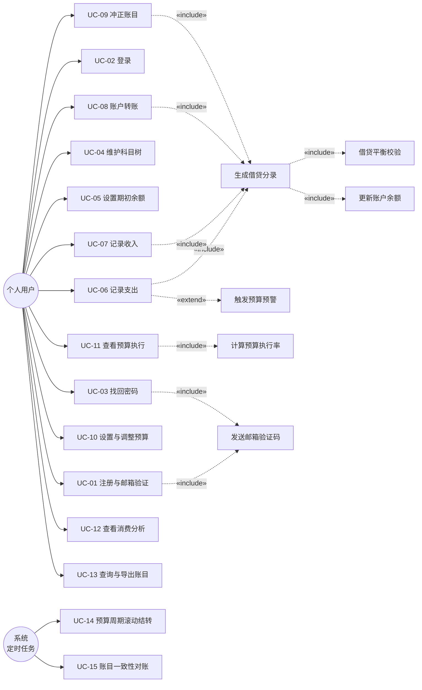
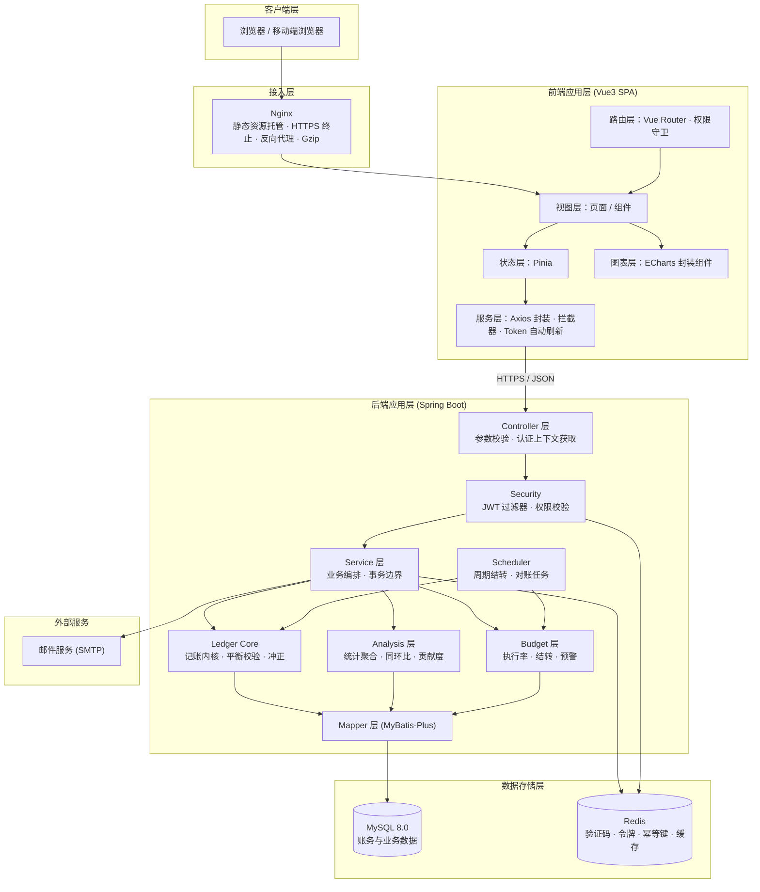
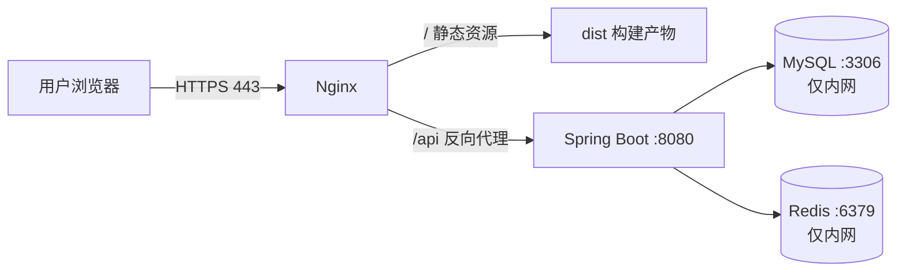
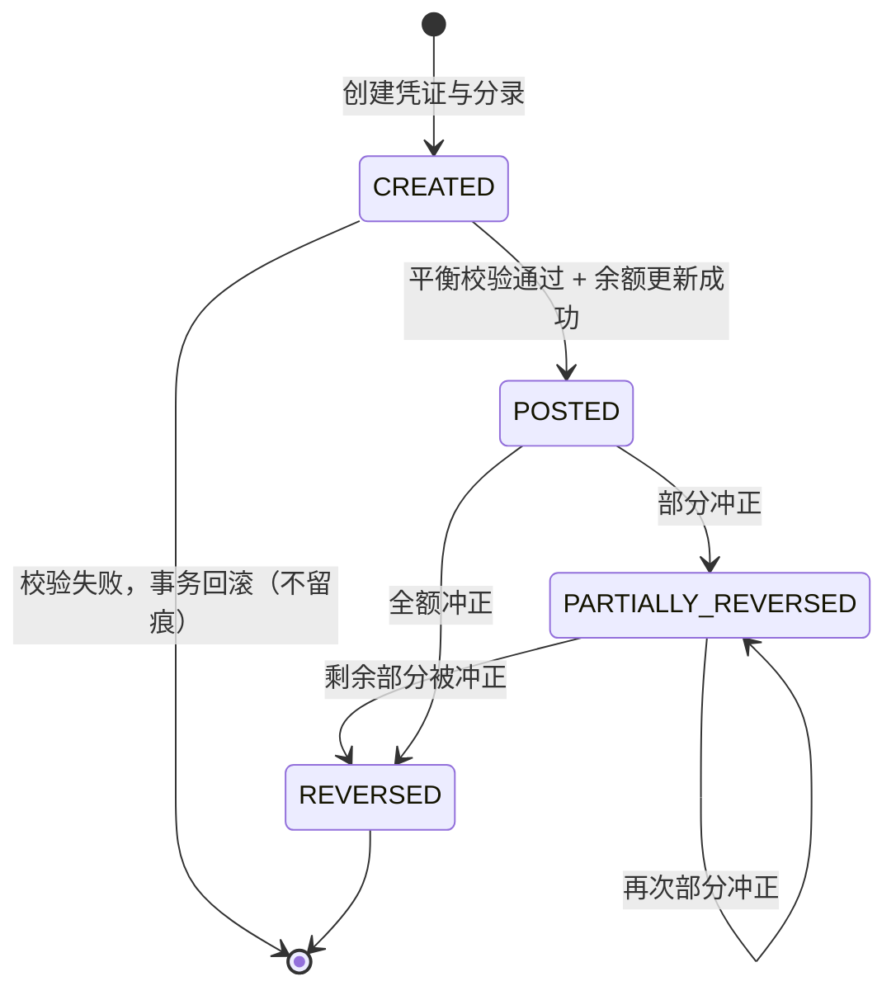
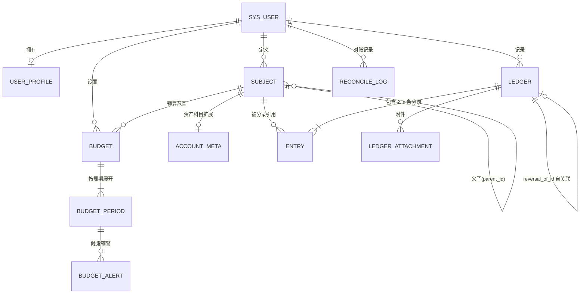
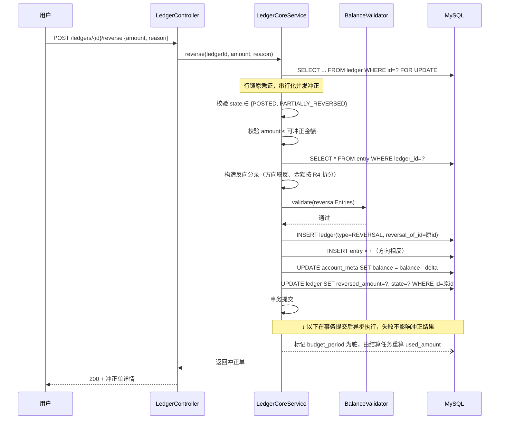
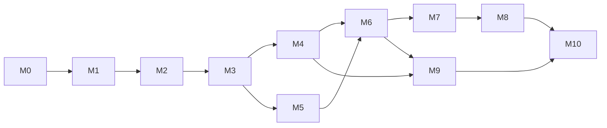

# 基于 Spring Boot + Vue3 的个人复式记账与消费分析系统

## 系统设计说明书

| 项目 | 内容 |
| --- | --- |
| 文档名称 | 系统设计说明书（个人开发用） |
| 版本 | v1.0 |
| 状态 | 设计基线（Baseline） |
| 数据库设计 | 见 [数据库设计.md](./数据库设计.md)（含完整建表 DDL） |
| 用途 | 作为编码、测试、答辩三阶段的唯一设计依据 |

### 修订记录

| 版本 | 日期 | 主要变更 |
| --- | --- | --- |
| v0.1 | — | 《简易设计说明书》：功能清单、业务流程、技术路线 |
| v1.0 | — | 补充会计科目体系与复式记账数据模型；明确冲正、预算结转、同环比等算法口径；补充用例、架构、接口、非功能需求 |

### v1.0 相对 v0.1 的关键修正

> 这一节是全文最重要的部分，说明为什么原方案必须改。

1. **原方案缺少「会计科目」这一层，导致复式记账在支出场景下不成立。**
   原稿将「资金账户」（银行卡、支付宝）与「消费分类」（餐饮、交通）设计为两套互不相干的实体。但一笔支出 30 元的分录必须写成「借 餐饮 30 / 贷 支付宝 30」，借贷双方分别是**费用类**与**资产类**，属于同一个分类体系下的不同科目。若分录两方只能填"账户"，则贷方无处安放，借贷平衡校验形同虚设。
   **修正：引入一张统一的 `subject`（会计科目）表**，资金账户与消费分类都作为科目树中的节点（分别挂在资产类、费用类下）。`account`、`category` 不再独立建表，而是 `subject` 的两种视图。详见 [数据库设计.md §2](./数据库设计.md#2-会计数据模型核心设计)。
2. **原方案未定义账户余额的来源与一致性机制。**
   **修正：** 余额以「分录汇总」为唯一真相（append-only 流水），`account` 上的 `balance` 仅作为**带行锁维护的缓存**，并提供「重算对账」接口用于校验。详见 §7.7。
3. **原方案「撤销冲正」只有名词没有语义。**
   **修正：** 明确采用**反向分录冲正**（不物理删除、不修改历史分录），定义单据状态机、幂等约束与部分冲正规则。详见 §7.4。
4. **原方案「预算滚动结转」缺少公式。**
   **修正：** 给出递推公式与三种结转模式（`NONE` 不结转 / `SURPLUS_ONLY` 仅结余结转 / `FULL` 完整结转含超支），并设计了下限保护以防超支复利累积。详见 §7.5.3。
5. **原方案「同比/环比」未定义基期对齐与零基期处理。**
   **修正：** 明确日窗口对齐规则、基期为 0 时的展示策略、树形科目聚合层级规则。详见 §7.6。
6. **补充原方案完全缺失的章节：** 用例模型（§3）、系统架构（§4）、接口设计（§6）、非功能需求（§8）、开发计划与验收（§9、§10）。

---

## 1. 项目概述

### 1.1 项目背景

个人记账类应用普遍存在两个问题：一是**记账即改数**，账户余额由用户手工维护或由收支累加得出，一旦出现漏记、重复记账或多账户间资金转移，账目便无法自我校验；二是**记完不分析**，流水只是流水，无法回答"这个月为什么比上个月多花了 800 元"这类问题。

本系统以**复式记账**作为账务内核，用借贷平衡约束保证任何一笔业务都不会凭空产生或消灭资金；在此基础上叠加**预算控制**与**多维消费分析**，使数据从"记录"走向"决策"。

### 1.2 建设目标

| 编号 | 目标 | 可验证的判据 |
| --- | --- | --- |
| G1 | 账务一致性 | 任一时刻对全部科目执行 `Σ借 = Σ贷` 校验必须成立；账户余额与分录汇总重算结果完全一致 |
| G2 | 多账户资金管理 | 支持任意资产科目之间的转账，转账为一笔业务、两条分录、原子提交 |
| G3 | 预算与记账联动 | 记账成功后，相关预算的执行率与剩余额度在同一次请求内完成更新并可查询 |
| G4 | 消费可解释 | 能回答"本月相对上月/去年同月，各科目贡献了多少增减"，而不只是给一个总数 |
| G5 | 账务可追溯 | 任何历史账目只能通过冲正改变其有效性，原始分录永不被修改或删除 |

### 1.3 设计原则

1. **账务不可变（append-only）**：`entry` 表只插入，不更新、不删除。纠错一律通过新增反向分录实现。
2. **汇总可重算**：所有派生数据（账户余额、预算执行额、统计指标）都必须能由 `entry` 表重新计算得出。派生数据只是缓存，不是真相。
3. **口径先定义再编码**：所有统计指标在本文档中必须有明确公式与边界处理（零值、缺期、跨年），代码不得临场发挥。
4. **先内核后外壳**：复式记账内核（记账 → 分录 → 平衡校验 → 余额更新 → 冲正）必须在写任何页面之前完成并通过测试。
5. **金额不用浮点**：数据库用 `DECIMAL(18,2)`，Java 用 `BigDecimal`，JSON 传输用字符串。

### 1.4 范围界定

**本期实现（v1.0）**

- 用户管理：注册、登录、邮箱验证码、个人信息、密码修改与找回
- 科目管理：科目树的增删改查、层级调整、账户属性维护
- 复式记账：支出、收入、账户转账；借贷平衡校验；冲正
- 预算管理：分类预算、周/月/自定义周期、执行统计、超支预警
- 消费分析：收支统计、类别占比、消费趋势、周/月统计、同比、环比、贡献度、预算执行分析
- 账目查询与导出（CSV/Excel）

**本期不实现（明确排除，避免范围蔓延）**

- 多币种与汇率：v1.0 仅支持单一本位币（人民币），金额字段不含币种维度
- 负债类科目（信用卡、花呗）的完整账务处理：预留 `subject_type` 枚举值，但 v1.0 界面不开放，信用卡按"资产科目可为负余额"简化处理
- 多用户共享账本、家庭账本
- 移动端 App（仅做响应式 Web）

**可选扩展（核心功能全部通过测试后方可启动）**

- 消费预测：移动平均、指数平滑、季节性分解；以 MAE、MAPE 评价。详见 §7.8

---

## 2. 需求分析

### 2.1 功能需求

编号规则：`FR-模块-序号`。优先级：P0 必须 / P1 应当 / P2 可选。

#### FR-U 用户管理

| 编号 | 需求 | 优先级 |
| --- | --- | --- |
| FR-U-01 | 用户可用邮箱 + 密码注册，邮箱需通过验证码验证后方可激活 | P0 |
| FR-U-02 | 用户可登录，获得访问令牌；支持令牌静默刷新 | P0 |
| FR-U-03 | 用户可修改昵称、头像、默认账本设置 | P1 |
| FR-U-04 | 用户可修改密码（需校验原密码） | P0 |
| FR-U-05 | 用户可通过邮箱验证码重置忘记的密码 | P1 |
| FR-U-06 | 验证码请求需做频率限制，防止接口被滥用 | P0 |

#### FR-A 科目与账户管理

| 编号 | 需求 | 优先级 |
| --- | --- | --- |
| FR-A-01 | 系统预置一套标准科目树（资产/收入/费用），新用户注册时自动初始化 | P0 |
| FR-A-02 | 用户可新增资产科目（记资金账户），如"招商银行卡""微信零钱" | P0 |
| FR-A-03 | 用户可新增、修改、删除费用与收入科目，支持父子层级（如 餐饮 → 午餐） | P0 |
| FR-A-04 | 科目删除受约束：存在分录引用时禁止删除，只允许停用 | P0 |
| FR-A-05 | 用户可查看单个科目的余额与资金变动明细 | P0 |
| FR-A-06 | 用户可调整科目排序、设置显示图标与颜色 | P2 |
| FR-A-07 | 用户可为资产科目设置期初余额，系统生成一张"期初建账"凭证 | P0 |
| FR-A-08 | 新用户注册时从科目模板一键初始化整套科目树，用户可在此基础上增删改 | P0 |

#### FR-L 复式记账

| 编号 | 需求 | 优先级 |
| --- | --- | --- |
| FR-L-01 | 记录一笔支出：填写金额、资产科目（付款方）、费用科目、日期、备注 | P0 |
| FR-L-02 | 记录一笔收入：填写金额、资产科目（收款方）、收入科目、日期、备注 | P0 |
| FR-L-03 | 记录一笔转账：填写金额、转出资产科目、转入资产科目、日期、备注 | P0 |
| FR-L-04 | 每笔业务自动生成借贷两条分录，系统强制校验 `Σ借 = Σ贷`，不等则拒绝提交 | P0 |
| FR-L-05 | 校验分录涉及科目均为叶子科目（不可对非叶子科目记账） | P0 |
| FR-L-06 | 校验科目方向合法性（收入类不可记借方、费用类不可记贷方等，见 §7.2） | P0 |
| FR-L-07 | 一笔业务的分录在同一事务内提交，全部成功或全部回滚 | P0 |
| FR-L-08 | 记账请求支持幂等键，防止网络重试导致重复记账 | P0 |
| FR-L-09 | 已记账单据可冲正，冲正生成反向分录，原单据标记为已冲正 | P0 |
| FR-L-10 | 支持部分冲正（冲正金额 ≤ 原金额） | P1 |
| FR-L-11 | 用户可查看一笔业务的完整分录（借贷两侧） | P1 |
| FR-L-12 | 支持借贷平衡的全局对账校验（管理员/开发自检用） | P1 |

#### FR-B 预算管理

| 编号 | 需求 | 优先级 |
| --- | --- | --- |
| FR-B-01 | 用户可对**费用类科目**设置预算（总额预算或分类预算） | P0 |
| FR-B-02 | 支持周预算、月预算、自定义周期（起止日期）预算 | P0 |
| FR-B-03 | 支持"每期自动重复"的预算模板，自动生成后续周期预算 | P1 |
| FR-B-04 | 系统按实际费用发生额自动计算预算已用额、剩余额、执行率 | P0 |
| FR-B-05 | 支持预算滚动结转（上期结余转入下期可用额） | P0 |
| FR-B-06 | 支持超支预警阈值配置（如执行率达 80% / 100% 时提醒） | P1 |
| FR-B-07 | 用户可查看某预算周期内的执行明细（哪些记账构成了这笔支出） | P1 |
| FR-B-08 | 预算口径可切换：含/不含被冲正的账目 | P1 |

#### FR-S 消费分析

| 编号 | 需求 | 优先级 |
| --- | --- | --- |
| FR-S-01 | 收入与支出总额统计（按时间范围） | P0 |
| FR-S-02 | 消费类别占比分析（饼图 / 树图，支持逐层下钻） | P0 |
| FR-S-03 | 消费趋势分析（按日/周/月的折线图） | P0 |
| FR-S-04 | 周/月消费统计报表 | P0 |
| FR-S-05 | 同比分析（与去年同期对比） | P0 |
| FR-S-06 | 环比分析（与上一相邻周期对比） | P0 |
| FR-S-07 | 类别贡献度分析（定位支出增减由哪些科目造成） | P0 |
| FR-S-08 | 预算执行分析（预算 vs 实际，多周期对比） | P0 |
| FR-S-09 | 图表支持时间范围切换、科目筛选 | P1 |

#### FR-Q 查询与导出

| 编号 | 需求 | 优先级 |
| --- | --- | --- |
| FR-Q-01 | 按时间范围、收支类型、科目、金额范围组合查询账目 | P0 |
| FR-Q-02 | 查询结果分页，支持按金额/时间排序 | P0 |
| FR-Q-03 | 导出查询结果为 CSV / Excel | P1 |
| FR-Q-04 | 导出内容遵循当前查询筛选条件 | P1 |

### 2.2 非功能需求摘要

完整内容见 §8。核心约束：

| 类别 | 要求 |
| --- | --- |
| 数据一致性 | 单笔业务的全部分录与余额更新必须原子提交；并发记账不得产生余额错账 |
| 金额精度 | 数据库 `DECIMAL(18,2)`，Java `BigDecimal`，禁止 `double`/`float` 参与金额运算 |
| 响应性能 | 常用查询 P95 < 500ms；分析类查询 P95 < 2s（数据量 ≤ 10 万条分录） |
| 安全 | 密码 BCrypt 加盐存储；JWT 签名校验；接口鉴权；SQL 注入与 XSS 防护；验证码限流 |
| 可追溯 | 分录不可修改删除；冲正留痕，可还原任意时点账目状态 |

---

## 3. 用例模型

### 3.1 用例图



### 3.2 用例描述（核心用例）

#### UC-06 记录支出

| 项 | 内容 |
| --- | --- |
| 参与者 | 个人用户 |
| 前置条件 | 用户已登录；存在至少一个资产科目（叶子）与一个费用科目（叶子） |
| 触发条件 | 用户在"记一笔"页面选择"支出"并提交 |
| 主流程 | 1. 用户填写金额、支出科目、付款账户、日期、备注<br/>2. 前端校验金额 > 0、科目非空、日期格式合法<br/>3. 前端携带 `Idempotency-Key` 调用 `POST /api/v1/ledgers/expense`<br/>4. 后端校验幂等键（已存在则直接返回上次结果）<br/>5. 后端校验科目存在、属于当前用户、为叶子科目、方向合法<br/>6. 创建 `ledger` 主记录（`ledger_type=EXPENSE`，`state=CREATED`）<br/>7. 生成两条 `entry`：借 费用科目 / 贷 资产科目<br/>8. 执行借贷平衡校验（§7.3）<br/>9. 更新资产科目余额（行锁 + 增减）<br/>10. `ledger.state` 置为 `POSTED`，记录 `posted_at`<br/>11. 触发预算执行额刷新与超支预警判定<br/>12. 提交事务，返回凭证号与更新后余额 |
| 异常流 | 4a. 幂等键重复 → 返回原结果，HTTP 200，不重复记账<br/>5a. 科目非叶子 → 返回 `SUBJECT_NOT_LEAF`，拒绝<br/>5b. 科目方向非法 → 返回 `SUBJECT_DIRECTION_INVALID`，拒绝<br/>6a. 金额 ≤ 0 → 返回 `AMOUNT_INVALID`，拒绝<br/>8a. 借贷不平衡 → 回滚事务，返回 `ENTRY_NOT_BALANCED`，记 error 级日志<br/>9a. 更新余额影响行数 ≠ 1 → 抛异常回滚（视为并发冲突） |
| 后置条件 | 产生一条 `POSTED` 状态的支出凭证及其两条分录；相关账户余额减少；相关预算执行额增加 |
| 业务规则 | BR-01 金额最多两位小数；BR-02 日期不得晚于当前日期 +1 天（容忍时区）；BR-03 单笔金额上限 1,000,000 元 |

#### UC-08 账户转账

| 项 | 内容 |
| --- | --- |
| 参与者 | 个人用户 |
| 前置条件 | 用户已登录；存在至少两个不同的资产科目（叶子） |
| 主流程 | 1. 用户选择转出账户、转入账户、金额、日期<br/>2. 后端校验转出 ≠ 转入，否则返回 `TRANSFER_SAME_ACCOUNT`<br/>3. 创建 `ledger`（`ledger_type=TRANSFER`）<br/>4. 生成分录：借 转入账户 500 / 贷 转出账户 500<br/>5. 平衡校验通过后，同一事务内更新两个账户余额<br/>6. 提交事务 |
| 异常流 | 2a. 转出与转入相同 → 拒绝<br/>4a. 余额不足 → **默认允许**（个人记账场景存在信用卡/透支，余额为负合法），但前端给出提示；若用户开启"严格模式"则返回 `BALANCE_NOT_ENOUGH` |
| 后置条件 | 转出账户余额减少、转入账户余额增加，总资产不变 |
| 业务规则 | BR-04 转账不产生费用/收入科目分录，因此不影响任何预算执行额；BR-05 转账不计入消费分析 |

> **设计要点：** UC-08 是复式记账相对单式记账的最直接收益点——总资产守恒可被系统自动验证。详见 §7.7 的一致性校验。

#### UC-09 冲正账目

| 项 | 内容 |
| --- | --- |
| 参与者 | 个人用户 |
| 前置条件 | 目标凭证存在、属于当前用户、状态为 `POSTED`、未被冲正过 |
| 主流程 | 1. 用户选择目标凭证，填写冲正原因（可选）与冲正金额（默认全额）<br/>2. 后端校验冲正金额 ∈ (0, 原金额 − 已冲正金额]<br/>3. 创建一张新的 `ledger`（`ledger_type=REVERSAL`，`reversal_of_id` 指向原凭证）<br/>4. 按原凭证分录的**方向与金额取反**生成新分录<br/>5. 平衡校验，更新相关科目余额（反向增减）<br/>6. 更新原凭证 `reversed_amount`；若全额冲正则 `state=REVERSED`，否则保持 `POSTED`<br/>7. 重新计算受影响周期的预算执行额 |
| 异常流 | 2a. 冲正金额超限 → 返回 `REVERSAL_AMOUNT_EXCEEDED`<br/>3a. 原凭证已被完全冲正 → 返回 `LEDGER_ALREADY_REVERSED`<br/>并发：同一凭证并发冲正由唯一索引 `uk_reversal_once` 兜底，第二个请求返回冲突 |
| 后置条件 | 产生一张反向凭证；原凭证不再计入统计；账户余额回到正确值；原分录与反向分录**均保留** |
| 业务规则 | BR-06 原分录与反向分录在统计口径中成对抵消，因此统计结果与"未记账"等价；BR-07 冲正不可再被冲正（禁止冲正一张冲正单） |

> 完整的冲正语义、状态机与幂等约束见 §7.4。

#### UC-10 设置与调整预算

| 项 | 内容 |
| --- | --- |
| 参与者 | 个人用户 |
| 主流程 | 1. 用户选择周期类型（周 / 月 / 自定义）、起止日期、预算范围（总额 or 指定费用科目）<br/>2. 填写预算额度、是否启用滚动结转、预警阈值<br/>3. 后端校验科目为费用类、周期不重叠（同科目同周期只允许一个有效预算）<br/>4. 保存预算；若启用滚动结转则计算本期 `rollover_in` |
| 异常流 | 3a. 周期重叠 → 返回 `BUDGET_PERIOD_OVERLAP`<br/>3b. 科目非费用类 → 返回 `BUDGET_SUBJECT_TYPE_INVALID` |
| 后置条件 | 预算生效，`budget_period` 记录生成，可用于执行分析 |

#### UC-12 查看消费分析

| 项 | 内容 |
| --- | --- |
| 参与者 | 个人用户 |
| 主流程 | 1. 用户选择分析类型（占比/趋势/同比/环比/贡献度）、时间范围、科目范围<br/>2. 后端按 §7.6 定义的口径聚合 `entry` 数据<br/>3. 返回图表所需的结构化数据（分类轴 + 系列数据） |
| 业务规则 | BR-08 所有分析默认口径为"`state ∈ {POSTED, REVERSED}` 的全部单据"，即冲正自动抵消；BR-09 树形科目按层级聚合，父科目金额 = 子科目之和，不重复累加；BR-10 基期为 0 时的处理见 §7.6.3 |

### 3.3 关键业务规则汇总

| 编号 | 规则 |
| --- | --- |
| BR-01 | 金额以 `DECIMAL(18,2)` 存储，最多两位小数，禁止浮点数参与运算 |
| BR-02 | 记账日期不得晚于服务器当前日期 + 1 天 |
| BR-03 | 单笔金额上限 1,000,000.00 元，下限 0.01 元 |
| BR-04 | 转账仅涉及资产类科目，不产生费用类分录，因此不影响预算 |
| BR-05 | 转账不计入消费分析与收支统计 |
| BR-06 | 冲正分录与原分录成对抵消，统计口径等价于该笔业务未发生 |
| BR-07 | 冲正单不可再被冲正 |
| BR-08 | 统计默认包含 `POSTED` 与 `REVERSED` 状态单据（靠分录符号自然抵消），如需"仅有效账目"可切换为排除 `REVERSED` 单据及其冲正单 |
| BR-09 | 科目树聚合时父节点金额由子节点汇总，查询明细时只取叶子科目 |
| BR-10 | 只有叶子科目可被记账 |
| BR-11 | 只有费用类科目可被设置预算 |
| BR-12 | 所有写操作要求 `Idempotency-Key` 请求头（前端对同一表单提交生成同一 UUID） |

---

## 4. 系统架构设计

### 4.1 总体架构



### 4.2 分层职责与依赖规则

| 层 | 职责 | 禁止事项 |
| --- | --- | --- |
| Controller | 接收请求、参数校验（`@Valid`）、从 `SecurityContext` 取 `userId`、组装统一响应体 | 禁止写业务逻辑、禁止直接调用 Mapper |
| Service | 业务编排、事务边界（`@Transactional`）、权限与业务规则校验、DTO ↔ Entity 转换 | 禁止处理 HTTP 对象（`HttpServletRequest`） |
| Ledger Core | 记账内核：分录构造、平衡校验、余额更新、冲正。**与 Web 层解耦，可独立单元测试** | 禁止依赖 Redis、SMTP 等外部设施 |
| Analysis / Budget | 只读聚合计算，返回统计 DTO | 禁止修改 `entry` 表 |
| Mapper | 数据访问，复杂统计用 XML 手写 SQL | 禁止写业务分支逻辑 |

**依赖方向单向向下：** Controller → Service → Core → Mapper → DB。反向依赖一律通过接口或事件解耦。

### 4.3 后端包结构

```
com.example.ledger
├── LedgerApplication.java
├── common
│   ├── result          Result<T>, PageResult<T>, ResultCode
│   ├── exception       BizException, GlobalExceptionHandler
│   ├── constant        科目类型/方向/单据类型/状态 枚举与常量
│   ├── util            MoneyUtil, DateRangeUtil, TreeUtil, IdempotentUtil
│   └── config          MybatisPlusConfig, RedisConfig, WebMvcConfig, JacksonConfig
├── security
│   ├── JwtTokenProvider, JwtAuthenticationFilter
│   ├── LoginUser, SecurityContextHolderHelper
│   └── PasswordEncoderConfig
├── module
│   ├── user            controller / service / mapper / entity / dto
│   ├── subject         （科目树：账户 + 收支分类）
│   ├── ledger          （记账内核：ledger / entry / 平衡校验 / 冲正）
│   ├── budget
│   ├── analysis
│   └── export
└── scheduler           BudgetRolloverJob, LedgerReconcileJob
```

### 4.4 前端工程结构

```
src/
├── api/                按模块封装的请求方法（user.ts / ledger.ts / budget.ts / analysis.ts）
├── assets/
├── components/
│   ├── common/         AppTable, AppDialog, MoneyText, EmptyState
│   ├── chart/          LineChart, PieChart, BarChart, TreemapChart（统一 ECharts 封装）
│   └── business/       SubjectTreeSelect, AccountSelect, AmountInput, LedgerForm
├── composables/        useRequest, usePagination, useChartResize
├── layouts/
├── router/             路由表 + 权限守卫
├── stores/             user.ts, subject.ts, ledger.ts（Pinia）
├── utils/              request.ts（Axios 实例）, auth.ts, money.ts, date.ts
├── views/
│   ├── login/  register/  findPassword/
│   ├── dashboard/
│   ├── ledger/         LedgerList.vue, LedgerForm.vue
│   ├── subject/        SubjectTree.vue
│   ├── budget/         BudgetList.vue, BudgetDetail.vue
│   ├── analysis/       Overview.vue, Trend.vue, Compare.vue, Contribution.vue
│   └── account/        Profile.vue
└── main.ts
```

### 4.5 技术选型说明

| 层面 | 选型 | 版本建议 | 选型理由 |
| --- | --- | --- | --- |
| 后端框架 | Spring Boot | 3.2.x（JDK 17） | 生态成熟；JDK 17 为当前 LTS，避免 JDK 8 的陈旧观感 |
| 持久层 | MyBatis-Plus | 3.5.x | 单表 CRUD 免写 SQL；复杂统计仍可手写 XML，比 JPA 更可控 |
| 数据库 | MySQL | 8.0 | 窗口函数（`SUM() OVER`）与 CTE 对统计聚合很关键，5.7 不具备 |
| 缓存 | Redis | 7.x | 验证码、令牌黑名单、幂等键、热点统计缓存 |
| 认证 | JWT（jjwt） | 0.12.x | 无状态鉴权，便于前后端分离与云部署 |
| 前端框架 | Vue 3 | 3.4+（Composition API + `<script setup>`） | 响应式模型清晰，组合式 API 便于逻辑复用 |
| UI 组件 | Element Plus | 2.x | 表单、表格、弹窗、日期选择器开箱即用 |
| 图表 | ECharts | 5.x | 折线/柱状/饼图/树图齐全，中文文档完善 |
| 构建 | Vite | 5.x | 开发热更新快，构建产物小 |
| 状态管理 | Pinia | 2.x | Vue3 官方推荐，替代 Vuex |
| 反向代理 | Nginx | 1.24+ | 静态托管 + HTTPS + 反向代理一体 |
| 部署 | 云服务器 + Docker Compose | — | 一键起 MySQL/Redis/后端/Nginx，环境可复现 |

**为什么不选 XXX（预判答辩提问）**

- 不用 JPA/Hibernate：账务统计需要大量自定义聚合 SQL，ORM 自动生成的 SQL 难以优化。
- 不用 MongoDB：复式记账的强一致性依赖关系型事务与行锁，文档数据库不适合作为账务主存储。
- 不用微服务：个人项目体量下微服务只增加部署与调试成本，无任何收益。

### 4.6 部署架构



- MySQL 与 Redis **不对外暴露端口**，仅允许应用服务器内网访问。
- HTTPS 证书使用 Let's Encrypt（Certbot）自动续期。
- 后端以 `systemd` 服务或 Docker 容器方式常驻，配置日志轮转。
- 数据库每日定时 `mysqldump` 备份，保留最近 7 天。

---

## 5. 数据库设计

> 本章仅给出会计数据模型的设计思路与关键约束，**完整的表清单、字段定义、索引、建表 DDL 与 Redis 键设计见 [数据库设计.md](./数据库设计.md)**。

### 5.1 会计数据模型核心设计

#### 5.1.1 为什么必须引入「科目」

复式记账的本质约束是：**每一笔业务至少涉及两个科目，借方合计恒等于贷方合计**。要满足这个约束，前提是"资金的来源与去向"都必须能表达为**同一套体系**中的科目。

- 买午餐 30 元：资金去向是"餐饮"（费用类科目），资金来源是"支付宝"（资产类科目）。
- 发工资 8000 元：资金来源是"工资"（收入类科目），资金去向是"银行卡"（资产类科目）。
- 银行卡转支付宝 500 元：资金来源是"银行卡"，去向是"支付宝"，两者都是资产类科目。

可见**资产、收入、费用必须共处一张科目表**，否则支出与收入分录永远只填得出一边。原方案把"账户"和"消费分类"分成两套实体，正是卡在这里。

#### 5.1.2 科目类型与正常余额方向

| 科目类型 | 编码前缀 | 正常余额方向 | 增加记 | 减少记 | 本系统用途 |
| --- | --- | --- | --- | --- | --- |
| 资产 `ASSET` | 1 | 借方 | 借 | 贷 | 银行卡、微信、支付宝、现金、储蓄 |
| 负债 `LIABILITY` | 2 | 贷方 | 贷 | 借 | v1.0 预留（信用卡），界面不开放 |
| 权益 `EQUITY` | 3 | 贷方 | 贷 | 借 | 预留（期初建账轧差用） |
| 收入 `INCOME` | 4 | 贷方 | 贷 | 借 | 工资、奖金、利息、其他收入 |
| 费用 `EXPENSE` | 5 | 借方 | 借 | 贷 | 餐饮、交通、娱乐、居住…… |

#### 5.1.3 业务场景 → 分录用例（验证模型正确性）

| 场景 | 借方分录 | 贷方分录 | 金额 | 性质 |
| --- | --- | --- | --- | --- |
| 买午餐 30 元 | 费用 / 餐饮 / 午餐 | 资产 / 支付宝 | 30.00 | 支出 |
| 发工资 8000 元 | 资产 / 银行卡 | 收入 / 工资 | 8000.00 | 收入 |
| 银行卡转支付宝 500 元 | 资产 / 支付宝 | 资产 / 银行卡 | 500.00 | 转账 |
| 期初建账：银行卡原有 10000 元 | 资产 / 银行卡 | 权益 / 期初余额 | 10000.00 | 建账 |
| 冲正上例午餐 30 元 | 资产 / 支付宝 | 费用 / 餐饮 / 午餐 | 30.00 | 冲正 |

**每行借贷金额相等，模型自洽。** 若把"账户"与"分类"拆成两张表，第 1 行与第 4 行的贷方将无处填写。

#### 5.1.4 单据状态机



> `CREATED` 是事务内的瞬时状态，正常提交后不会持久存在；保留该状态是为了在事务未提交时进行断言与日志排查。

### 5.2 表清单总览

| 分组 | 表名 | 说明 |
| --- | --- | --- |
| 用户 | `sys_user` | 用户账号 |
| 用户 | `user_profile` | 用户偏好设置（货币符号、严格余额模式、预警阈值） |
| 科目 | `subject` | **会计科目树**（资产/负债/权益/收入/费用 五类合一） |
| 科目 | `account_meta` | 资产科目的账户扩展属性（开户行、卡号后四位、余额缓存） |
| 账务 | `ledger` | 记账凭证（一笔业务一条） |
| 账务 | `entry` | **会计分录明细（借/贷两行）—— 账务数据的唯一真相** |
| 账务 | `ledger_attachment` | 凭证附件（票据照片，P2） |
| 预算 | `budget` | 预算定义（范围、周期类型、额度） |
| 预算 | `budget_period` | 预算周期实例（每期一行，含额度、已用、结转） |
| 预算 | `budget_alert` | 预警记录 |
| 辅助 | `reconcile_log` | 对账校验执行记录 |

> **注意：没有 `category` 表。** 消费分类即 `subject` 中 `subject_type = EXPENSE` 的子树；资金账户即 `subject_type = ASSET` 的子树。

### 5.3 ER 图



**约束要点：**

- `SUBJECT.parent_id` 自关联构成科目树；`path` 字段存物化路径（如 `/1/12/125/`），子树查询用 `path LIKE '/1/12/%'`，避免递归。
- `LEDGER.reversal_of_id` 自关联，唯一索引限制一张单据只能被全额冲正一次。
- `ENTRY.ledger_id` 删除策略为 `RESTRICT`：**只要存在分录，凭证不可删除**（物理上保障不可变）。

---

## 6. 接口设计

### 6.1 通用规范

#### 6.1.1 路径与版本

- 统一前缀 `/api/v1`，版本变化时新增 `/api/v2` 而非改动 v1。
- 资源命名用复数名词，动作用 HTTP 方法表达；确需动作语义时用子路径（如 `/ledgers/{id}/reverse`）。

#### 6.1.2 统一响应体

```json
{
  "code": 0,
  "message": "success",
  "data": { },
  "traceId": "b7f3c1e2-...",
  "timestamp": "2025-03-01T10:23:45+08:00"
}
```

| 字段 | 说明 |
| --- | --- |
| `code` | 0 表示成功；非 0 为业务错误码（见 §6.1.4） |
| `message` | 面向用户的提示文案，可直接展示 |
| `data` | 业务数据；无数据时为 `null` |
| `traceId` | 链路追踪 ID，便于按日志定位问题 |

分页响应：`data` 结构为 `{ "records": [], "total": 128, "page": 1, "size": 20, "pages": 7 }`。

#### 6.1.3 认证与幂等

| 项 | 约定 |
| --- | --- |
| 认证 | `Authorization: Bearer <accessToken>`；accessToken 有效期 30 分钟 |
| 刷新 | refreshToken 存于 Redis（有效期 14 天），`POST /api/v1/auth/refresh` 换取新令牌 |
| 令牌失效 | 返回 HTTP 401 + `code=1001 (TOKEN_EXPIRED)`；前端拦截器自动静默刷新并重放原请求一次 |
| 退出登录 | accessToken 加入 Redis 黑名单，TTL = 剩余有效期 |
| 幂等 | 所有写操作必须携带 `Idempotency-Key: <uuid>`；服务端用 Redis `SETNX` 占位，TTL 24h，命中则返回首次结果 |
| 金额 | 请求与响应中的金额一律为**字符串**（如 `"30.00"`），避免 JSON 浮点精度丢失 |
| 时间 | ISO 8601 带时区，如 `"2025-03-01T00:00:00+08:00"`；仅日期字段用 `"2025-03-01"` |
| 命名 | JSON 字段 `camelCase`；数据库字段 `snake_case`；由 Jackson 配置自动映射 |

#### 6.1.4 错误码

| 码段 | 含义 | 示例 |
| --- | --- | --- |
| 0 | 成功 | — |
| 1000–1099 | 认证与权限 | 1001 TOKEN_EXPIRED、1002 TOKEN_INVALID、1003 NO_PERMISSION、1004 ACCOUNT_DISABLED |
| 1100–1199 | 参数校验 | 1101 PARAM_INVALID、1102 AMOUNT_INVALID、1103 DATE_INVALID |
| 1200–1299 | 用户 | 1201 EMAIL_EXISTS、1202 USER_NOT_FOUND、1203 PASSWORD_ERROR、1204 CODE_INVALID、1205 CODE_EXPIRED、1206 CODE_SEND_TOO_FREQUENT |
| 1300–1399 | 科目 | 1301 SUBJECT_NOT_FOUND、1302 SUBJECT_HAS_CHILDREN、1303 SUBJECT_IN_USE、1304 SUBJECT_NOT_LEAF、1305 SUBJECT_DIRECTION_INVALID、1306 SUBJECT_TYPE_INVALID |
| 1400–1499 | 账务 | 1401 ENTRY_NOT_BALANCED、1402 LEDGER_NOT_FOUND、1403 LEDGER_ALREADY_REVERSED、1404 REVERSAL_AMOUNT_EXCEEDED、1405 TRANSFER_SAME_ACCOUNT、1406 BALANCE_NOT_ENOUGH、1407 LEDGER_STATE_INVALID |
| 1500–1599 | 预算 | 1501 BUDGET_NOT_FOUND、1502 BUDGET_PERIOD_OVERLAP、1503 BUDGET_SUBJECT_TYPE_INVALID、1504 BUDGET_AMOUNT_INVALID |
| 1900–1999 | 系统 | 1901 INTERNAL_ERROR、1902 DB_ERROR、1903 CACHE_ERROR、1904 MAIL_SEND_FAILED |

HTTP 状态码策略：业务错误统一返回 **HTTP 200 + 非 0 code**（便于前端统一处理）；仅认证失败返回 401、无权限 403、系统异常 500。

### 6.2 接口清单

#### 6.2.1 认证模块 `/api/v1/auth`

| 方法 | 路径 | 说明 | 幂等 |
| --- | --- | --- | --- |
| POST | `/auth/code` | 发送邮箱验证码（type: REGISTER / RESET_PWD） | 需 |
| POST | `/auth/register` | 注册（邮箱 + 密码 + 验证码） | 需 |
| POST | `/auth/login` | 登录，返回双令牌 | 否 |
| POST | `/auth/refresh` | 刷新访问令牌 | 否 |
| POST | `/auth/logout` | 退出登录 | 否 |
| POST | `/auth/password/reset` | 验证码重置密码 | 需 |
| PUT | `/auth/password` | 登录态修改密码 | 需 |

#### 6.2.2 用户模块 `/api/v1/users`

| 方法 | 路径 | 说明 |
| --- | --- | --- |
| GET | `/users/me` | 获取当前用户信息与偏好设置 |
| PUT | `/users/me` | 修改昵称、头像、偏好 |
| PUT | `/users/me/preferences` | 修改严格余额模式、预警阈值等 |

#### 6.2.3 科目模块 `/api/v1/subjects`

| 方法 | 路径 | 说明 |
| --- | --- | --- |
| GET | `/subjects/tree` | 获取科目树（可按 type 过滤） |
| GET | `/subjects/{id}` | 科目详情（含余额，仅资产类） |
| POST | `/subjects` | 新增科目（可指定 parentId 或复制模板） |
| PUT | `/subjects/{id}` | 修改科目名称、图标、排序、启用状态 |
| DELETE | `/subjects/{id}` | 删除科目（受 FR-A-04 约束） |
| PUT | `/subjects/{id}/move` | 调整父节点（层级迁移） |
| GET | `/subjects/{id}/balance` | 资产科目余额与统计 |
| GET | `/subjects/{id}/entries` | 该科目的分录流水（分页） |
| POST | `/subjects/init-opening` | 设置期初余额，生成建账凭证 |
| GET | `/subjects/templates` | 预置科目模板（新用户初始化用） |

#### 6.2.4 账务模块 `/api/v1/ledgers`

| 方法 | 路径 | 说明 |
| --- | --- | --- |
| POST | `/ledgers/expense` | 记一笔支出 |
| POST | `/ledgers/income` | 记一笔收入 |
| POST | `/ledgers/transfer` | 记一笔转账 |
| GET | `/ledgers` | 账目分页查询（时间/类型/科目/金额区间/关键字） |
| GET | `/ledgers/{id}` | 凭证详情（含借贷两条分录） |
| POST | `/ledgers/{id}/reverse` | 冲正（body: `{ amount, reason }`） |
| DELETE | `/ledgers/{id}` | **不提供**。物理删除被架构上禁止，仅可通过冲正纠错 |
| GET | `/ledgers/balance-check` | 借贷平衡全局校验（开发自检） |
| GET | `/ledgers/summary` | 期间收支汇总（收入/支出/结余） |

> **关于"混合支付 / 拆分记账"（明确排除，但数据模型已兼容）：**
> 现实中存在"一笔 300 元的餐费，200 元刷卡、100 元用微信"的场景。v1.0 **不支持**，用户需拆成两笔记账。
> 之所以能放心排除，是因为账务模型本身是一张`ledger`（凭证）挂 N 条 `entry`（分录），天然支持"一借多贷"。将来要支持时，只需把 `expense` 接口的请求体从"单个 `assetSubjectId`"扩展为"`payments: [{subjectId, amount}]` 数组"，并在 §7.3.1 的 C6 校验中放宽"恰好两条分录"的假设——**表结构无需任何改动**。
> 这也解释了为什么不把 `ledger` 设计成"一条支出记录"：**凭证与分录分离正是为了让这种扩展不需要改表。**

**请求示例：记一笔支出**

```http
POST /api/v1/ledgers/expense
Authorization: Bearer eyJhbGciOi...
Idempotency-Key: 3f2a9c14-8b7e-4d21-9f0a-6c5e2b1d4a77
Content-Type: application/json

{
  "amount": "30.00",
  "expenseSubjectId": 125,
  "assetSubjectId": 12,
  "occurredAt": "2025-03-01",
  "remark": "公司楼下快餐"
}
```

**响应示例**

```json
{
  "code": 0,
  "message": "success",
  "data": {
    "ledgerId": 90001,
    "ledgerNo": "LE20250301001",
    "ledgerType": "EXPENSE",
    "state": "POSTED",
    "amount": "30.00",
    "entries": [
      { "entryNo": 1, "direction": "DEBIT",  "subjectId": 125, "subjectName": "午餐", "amount": "30.00" },
      { "entryNo": 2, "direction": "CREDIT", "subjectId": 12,  "subjectName": "支付宝", "amount": "30.00" }
    ],
    "affectedBalances": [
      { "subjectId": 12, "subjectName": "支付宝", "balanceBefore": "1520.00", "balanceAfter": "1490.00" }
    ]
  },
  "traceId": "b7f3c1e2-...",
  "timestamp": "2025-03-01T10:23:45+08:00"
}
```

#### 6.2.5 预算模块 `/api/v1/budgets`

| 方法 | 路径 | 说明 |
| --- | --- | --- |
| GET | `/budgets` | 预算列表（按当前周期返回执行情况） |
| POST | `/budgets` | 新建预算（含周期、范围、额度、结转开关） |
| GET | `/budgets/{id}` | 预算详情 |
| PUT | `/budgets/{id}` | 修改额度、预警阈值、结转开关 |
| DELETE | `/budgets/{id}` | 删除预算（保留历史周期数据） |
| GET | `/budgets/{id}/periods` | 该预算的周期列表（含额度、已用、结转、执行率） |
| GET | `/budgets/{id}/execution` | 当前周期执行情况（含趋势序列，供图表） |
| GET | `/budgets/alerts` | 预警列表（未读/已读） |
| PUT | `/budgets/alerts/{id}/read` | 标记预警已读 |

#### 6.2.6 分析模块 `/api/v1/analysis`

| 方法 | 路径 | 说明 | 关键参数 |
| --- | --- | --- | --- |
| GET | `/analysis/overview` | 总览：收入、支出、结余、净资产 | `startDate`, `endDate` |
| GET | `/analysis/category-share` | 类别占比（饼图/树图，支持下钻） | `startDate`, `endDate`, `level`, `parentId` |
| GET | `/analysis/trend` | 消费趋势序列 | `granularity=DAY/WEEK/MONTH`, `startDate`, `endDate`, `subjectIds` |
| GET | `/analysis/period-report` | 周/月报表 | `granularity`, `period` |
| GET | `/analysis/compare` | 同比 + 环比（同时返回两者，便于同图对比） | `granularity`, `period`, `subjectIds`, `alignWindow=true` |
| GET | `/analysis/contribution` | 类别贡献度（谁造成了增减） | `granularity`, `period`, `compareType=YOY/MOM` |
| GET | `/analysis/budget-execution` | 预算执行分析（预算 vs 实际，多周期） | `budgetId` 或 `subjectId`, `periodCount` |
| GET | `/analysis/export` | 导出分析结果 | 同查询参数 |

**响应示例：`/analysis/compare`**

```json
{
  "code": 0,
  "message": "success",
  "data": {
    "granularity": "MONTH",
    "current":  { "period": "2025-03", "startDate": "2025-03-01", "endDate": "2025-03-31", "amount": "5860.00" },
    "momBase":  { "period": "2025-02", "startDate": "2025-02-01", "endDate": "2025-02-28", "amount": "5040.00" },
    "yoyBase":  { "period": "2024-03", "startDate": "2024-03-01", "endDate": "2024-03-31", "amount": "6120.00" },
    "mom": { "diff": "820.00", "rate": "16.27", "rateAvailable": true },
    "yoy": { "diff": "-260.00", "rate": "-4.25", "rateAvailable": true },
    "windowAligned": false
  }
}
```

> `rateAvailable` 为 `false` 时 `rate` 返回 `null`，前端展示"—（基期无数据）"而非无穷大或 0。详见 §7.6.3。

#### 6.2.7 导出模块 `/api/v1/export`

| 方法 | 路径 | 说明 |
| --- | --- | --- |
| POST | `/export/ledgers` | 按查询条件异步导出账目（CSV/Excel） |
| GET | `/export/tasks/{taskId}` | 查询导出任务状态与下载链接 |

> 导出任务写入磁盘临时目录，通过一次性 token 下载，有效期 30 分钟。同步导出仅用于结果集 < 5000 条的场景。

### 6.3 前端请求封装要点

```ts
// utils/request.ts 关键行为
// 1. 请求拦截：注入 Authorization、Idempotency-Key（写操作自动生成 UUID）、traceId
// 2. 响应拦截：code !== 0 时统一抛 BizError；401 + 1001 触发静默刷新并重放一次
// 3. 刷新并发控制：多个请求同时 401 时，仅发起一次 refresh，其余请求排队等待结果
// 4. 金额处理：请求前把用户输入的字符串原样提交，响应后不做 Number() 转换
// 5. 取消重复请求：同一 URL + 参数 + 方法在途时取消前一个
```

---

## 7. 关键算法设计

> 本章所有公式即为实现依据。编码时若发现需偏离公式，必须同步修订本章，禁止代码与文档不一致。

### 7.1 金额表示与运算规则

| 项 | 规则 |
| --- | --- |
| 存储 | MySQL `DECIMAL(18,2)`，禁止 `FLOAT`/`DOUBLE` |
| Java | `BigDecimal`，统一使用 `MoneyUtil` 工具类 |
| 舍入 | 所有需要舍入处使用 `RoundingMode.HALF_UP`，保留 2 位 |
| 比较 | 使用 `compareTo()`，**禁止 `equals()`**（`new BigDecimal("1.0").equals(new BigDecimal("1.00"))` 为 `false`） |
| 零值判断 | `amount.compareTo(BigDecimal.ZERO) > 0`，用常量 `MoneyUtil.ZERO` 而非每次 new |
| 分转元 | 仅在展示层做格式化，运算全程保持 `BigDecimal` |
| 负数 | 冲正分录金额以**正数 + 相反方向**表达，不使用负数金额，便于阅读与校验 |

### 7.2 科目方向合法性校验

不同科目类型允许的记账方向如下表。分录方向不合法时直接拒绝（错误码 1305），这是防止账务语义错乱的第一道闸门。

| 科目类型 | 允许借方（DEBIT） | 允许贷方（CREDIT） | 说明 |
| --- | --- | --- | --- |
| 资产 ASSET | ✅ 增加 | ✅ 减少 | 两向均合法 |
| 负债 LIABILITY | ✅ 减少 | ✅ 增加 | 两向均合法 |
| 权益 EQUITY | ✅ 减少 | ✅ 增加 | 两向均合法 |
| 收入 INCOME | ❌ | ✅ | 收入只能贷记；借记等于冲减收入 |
| 费用 EXPENSE | ✅ | ❌ | 费用只能借记；贷记等于冲减费用 |

**特殊情形：冲正分录允许"反向方向"。**
冲正一张支出凭证时，需要「借 资产 / 贷 费用」。此时费用科目出现在贷方，与上表冲突。处理方式：**校验前置在凭证类型层面**——

- `ledger_type ∈ {EXPENSE, INCOME, TRANSFER, OPENING}` 时，按上表严格校验；
- `ledger_type = REVERSAL` 时，校验规则改为「与原凭证分录方向完全相反且金额相等」，跳过 §7.2 表校验。

这样既保证正常业务语义正确，又让冲正有明确且可验证的规则。

### 7.3 借贷平衡校验算法

#### 7.3.1 单张凭证校验

对凭证 `L` 的全部分录集合 `E(L)`：

```
借方差额 D = Σ { e.amount | e ∈ E(L) 且 e.direction = DEBIT  }
贷方差额 C = Σ { e.amount | e ∈ E(L) 且 e.direction = CREDIT }
```

约束条件（全部必须成立，否则抛 `ENTRY_NOT_BALANCED`，事务回滚）：

| 编号 | 约束 | 说明 |
| --- | --- | --- |
| C1 | `E(L)` 数量 ≥ 2 | 单条分录不构成复式记账 |
| C2 | `D = C` | **借贷平衡**，`compareTo() == 0` |
| C3 | 每条 `e.amount > 0` | 无零金额、无负数分录 |
| C4 | 每条 `e.subjectId` 为叶子科目 | 见 BR-10 |
| C5 | 每条分录科目属于当前登录用户 | 防止越权记账 |
| C6 | `E(L)` 内科目组合符合凭证类型 | 如 TRANSFER 两条分录均为 ASSET |
| C7 | 金额精度 ≤ 2 位小数 | 超出则拒绝，不做静默舍入 |

实现要点：

```java
// LedgerCoreService 伪代码
public Ledger post(LedgerDraft draft) {
    List<Entry> entries = entryBuilder.build(draft);   // 按业务类型构造分录
    BalanceValidator.validate(entries);                // C1~C7，失败抛 BizException
    validateIdempotent(draft.getIdempotencyKey());     // Redis SETNX 占位
    Ledger ledger = ledgerMapper.insert(draft.toEntity(State.CREATED));
    entries.forEach(e -> entryMapper.insert(e.withLedgerId(ledger.getId())));
    entries.stream()
           .map(Entry::getSubjectId).distinct()
           .forEach(id -> subjectBalanceService.applyDelta(id, deltaOf(id, entries), ledger.getId()));
    ledgerMapper.markPosted(ledger.getId(), now());
    budgetService.markDirty(ledger.getId());           // 仅置脏标记，重算在提交后异步执行
    return ledgerMapper.selectDetail(ledger.getId());
}
```

> **注意最后一行之前的 `markDirty`。** 预算执行额的重算**不能**放在这个事务内直接做（会拖长持锁时间，且预警失败会导致记账回滚）。这里只写脏标记，实际重算由 `@TransactionalEventListener(phase = AFTER_COMMIT)` 触发的异步任务完成（§7.5.4、§7.7.2）。

#### 7.3.2 全局对账校验

```sql
-- 全部科目层面：借方合计必须等于贷方合计
SELECT
  SUM(CASE WHEN direction = 'DEBIT'  THEN amount ELSE 0 END) AS total_debit,
  SUM(CASE WHEN direction = 'CREDIT' THEN amount ELSE 0 END) AS total_credit,
  SUM(CASE WHEN direction = 'DEBIT'  THEN amount ELSE -amount END) AS diff
FROM entry;
-- 期望 diff = 0.00，非 0 即为系统级严重错误，需立即告警排查
```

```sql
-- 账户余额与分录汇总的一致性（逐科目比对）
SELECT
  s.id,
  s.name,
  am.balance                                     AS cached_balance,
  COALESCE(SUM(e.signed_amount), 0)              AS computed_balance,
  am.balance - COALESCE(SUM(e.signed_amount), 0) AS diff
FROM subject s
JOIN account_meta am ON am.subject_id = s.id
LEFT JOIN entry e ON e.subject_id = s.id
WHERE s.subject_type = 'ASSET' AND s.deleted = 0
GROUP BY s.id, s.name, am.balance
HAVING diff <> 0;
-- 期望 0 行。有结果说明缓存余额与流水不一致，需触发重算修复
```

#### 7.3.3 `signed_amount` 的设计意图

每条分录除 `amount` 外冗余存储一个带符号金额：

```
e.signed_amount = (e.direction = DEBIT) ? e.amount : -e.amount
```

这样"任意科目的余额"都退化为一个无脑求和：

```
科目余额 signed = Σ e.signed_amount  （对该科目全部分录）
```

无需在 SQL 里反复写 `CASE WHEN direction`。余额的**方向语义**再单独处理，见 §7.3.4。

#### 7.3.4 余额的方向语义

`signed_amount` 求和得到的是"借方为正"的金额。展示给用户时需要按科目类型的正常余额方向换算：

| 科目类型 | 展示余额公式 | 举例 |
| --- | --- | --- |
| 资产 ASSET | `balance = signed` | 支付宝 signed = −30 → 展示 −30.00（透支） |
| 费用 EXPENSE | `balance = signed` | 餐饮 signed = +90 → 本月餐饮 90.00 |
| 收入 INCOME | `balance = −signed` | 工资 signed = −8000 → 展示 8000.00 |
| 负债 LIABILITY | `balance = −signed` | 信用卡 signed = −500 → 展示欠款 500.00 |
| 权益 EQUITY | `balance = −signed` | 期初权益 signed = −10000 → 展示 10000.00 |

> 统一用 `signed_amount` 存储、用 `SubjectType.normalSide()` 换算展示，可避免"资产负债表两边符号不一致"这类经典 bug。

### 7.4 冲正算法

#### 7.4.1 语义定义

| 项 | 定义 |
| --- | --- |
| 冲正方式 | **反向分录法（红字冲销的等价形式）**：新增一张独立凭证，其分录方向与原凭证**逐条相反**、金额相等 |
| 是否修改原分录 | **否**。原 `entry` 行永不更新或删除 |
| 原凭证状态 | 全额冲正 → `REVERSED`；部分冲正 → `PARTIALLY_REVERSED` |
| 是否可再冲正冲正单 | **否**（BR-07）。冲正单 `ledger_type=REVERSAL`，接口层拒绝对其发起冲正 |
| 冲正单能否删除 | 否。若冲正错了，通过再冲正原凭证的剩余可冲金额来修正（需先撤销冲正单，见下文说明） |

#### 7.4.2 可冲正金额

```
可冲正金额 = 原凭证金额 − 已冲正金额（reversed_amount）
```

约束：

| 编号 | 规则 |
| --- | --- |
| R1 | 冲正金额 `> 0` 且 `≤ 可冲正金额`，否则返回 `REVERSAL_AMOUNT_EXCEEDED` |
| R2 | 默认冲正金额 = 可冲正金额（全额） |
| R3 | 单张原凭证的所有冲正单金额之和 ≤ 原凭证金额（数据库层面用 `reversed_amount` 行锁 + 校验双重保障） |
| R4 | 部分冲正时，反向分录金额按比例拆分到各条原分录：`冲正分录金额 = 原分录金额 × (冲正金额 / 原凭证金额)`，最后一条承担舍入差额，保证冲正单自身借贷平衡 |

> **R4 的实现细节：** 原凭证金额 100.00，两条分录各 100.00（借费用/贷资产），用户冲正 33.33。按比例每条为 33.33，恰好平衡。若原凭证为三条分录（如一笔含税拆分），出现除不尽时，前 n−1 条按 `HALF_UP` 舍入，最后一条用 `冲正金额×2 − 已分配合计` 补齐，再校验借贷相等。

#### 7.4.3 冲正流程



> **图中"标记为脏"而非"就地扣减"是刻意的。** 若在事务内直接 `used_amount = used_amount - ?`，则变成增量累加，一旦某次失败或重复执行就会永久漂移（说明书 §7.5.4 已明确禁止增量累加）。正确做法是只置脏标记，由结算任务按 `entry` 重算。

#### 7.4.4 幂等与并发

| 场景 | 防护机制 |
| --- | --- |
| 用户重复点击"冲正" | 前端同一按钮沿用同一 `Idempotency-Key`；服务端 Redis 命中直接返回首次结果 |
| 两个请求同时冲正同一凭证 | `SELECT ... FOR UPDATE` 行锁串行化；后到者看到 `reversed_amount` 已更新，若超额则拒绝 |
| 分布式部署下的重复入账 | 唯一索引 `uk_idempotency(user_id, idempotency_key)` 兜底（数据库层最终保障） |

#### 7.4.5 统计口径影响

```
统计口径 A（默认，BR-08）：包含全部 POSTED + REVERSED 单据
  → 原分录 + 相反分录，求和天然为 0，等价于"该笔业务未发生"
  → 优点：SQL 简单，无需 JOIN 排除逻辑，且天然支持部分冲正的按比例抵消

统计口径 B（可选）：排除 state=REVERSED 的原单据及其冲正单
  → 优点：明细列表更干净，不显示两张互相抵消的记录
  → 缺点：SQL 需额外过滤，且部分冲正场景下原单据仍需保留（金额要按比例扣减）
```

**v1.0 采用口径 A 作为统计默认口径，口径 B 仅在"账目明细列表"中作为展示选项提供。** 这样统计的 SQL 复杂度最低，且不可能算错——冲正的正确性由代数和自动保证。

### 7.5 预算执行与滚动结转算法

#### 7.5.1 周期窗口计算

给定周期类型与基准日期 `d`，计算该周期窗口 `[start, end]`：

| 周期类型 | 窗口规则 |
| --- | --- |
| `WEEK` | 以用户配置的周起始日（默认周一）为准：`start = d − (weekday(d) − weekStart + 7) mod 7`，`end = start + 6 天` |
| `MONTH` | `start = 当月 1 日`，`end = 当月最后一天` |
| `CUSTOM` | 用户在 `budget_period` 中显式指定 `start_date` 与 `end_date` |

> **周预算的坑：** 一年不恰好包含整数个周，跨年周的归属必须显式规定。**约定：跨年周归属于包含该周起始日的那一年。** 若不规定，12 月末的周预算会与次年 1 月初重复计算。

#### 7.5.2 预算范围与已用额

预算的 `scope_type` 决定 `used_amount` 的取数方式：

| 范围类型 | 取数 SQL 口径 |
| --- | --- |
| `TOTAL`（总预算） | 全部 `EXPENSE` 类科目在该周期内、该用户下，借方净发生额 |
| `SUBJECT`（分类预算） | 指定科目**及其全部后代科目**在该周期内的借方净发生额（按 `path LIKE` 匹配子树） |

```sql
-- 分类预算已用额（含子树，冲正自然抵消）
SELECT COALESCE(SUM(e.signed_amount), 0) AS used_amount
FROM entry e
JOIN ledger l ON l.id = e.ledger_id AND l.user_id = #{userId}
JOIN subject s ON s.id = e.subject_id
WHERE s.path LIKE CONCAT(#{budgetSubjectPath}, '%')
  AND s.subject_type = 'EXPENSE'
  AND l.occurred_date BETWEEN #{periodStart} AND #{periodEnd};
```

> 由于费用科目的 `signed_amount` 在借方为正、贷方为负，冲正分录（贷费用）会自动以负值抵消，**无需额外排除逻辑**。这是 §7.3.3 设计的直接收益。

#### 7.5.3 滚动结转递推公式

设第 `n` 期：

```
limit_n        = 第 n 期的预算额度（用户设定）
carry_n        = 第 n 期期初结转额（上期结转而来）
available_n    = limit_n + carry_n          ← 本期可用额
used_n         = 本期实际费用发生额
remaining_n    = available_n − used_n        ← 本期结余（可为负）
execution_rate = used_n / available_n × 100%  （available_n = 0 时返回 null）
```

结转开关 `rollover_enabled` 决定下一期期初结转额：

**模式 1：向上结转（默认，`rollover_enabled = false` 时等价于无结转）**

```
carry_{n+1} = 0                                  （不结转）
```

**模式 2：余额结转（`rollover_mode = SURPLUS_ONLY`）**

```
carry_{n+1} = max(0, remaining_n)                 （只把结余转下去，超支不惩罚下期）
```

**模式 3：完整结转（`rollover_mode = FULL`）**

```
carry_{n+1} = remaining_n                         （超支以负数转下去，下期可用额被扣减）
```

**推荐默认值为模式 2**：模型最直观（"上期省下的钱这期还能花"），且不会因为某一期超支导致后续所有周期的可用额被永久侵蚀。

> **防复利设计：** 模式 3 下若连续超支，`carry` 会持续累积为越来越大的负数，用户会看到"本期可用额为 −2000"这种难以理解的数字。因此 `available_n` 增加下限保护：**当 `available_n < 0` 时，展示层截断为 0 并额外提示"累计超支 X 元"，`carry` 仍按公式计算但不再参与后续累积（引入 `carry_floor` 字段记录被截断的部分）。** 该规则的取舍是：宁可少扣，不可让数字失去可解释性。

#### 7.5.4 结转的触发时机与幂等

| 项 | 设计 |
| --- | --- |
| 触发时机 | 定时任务在每个周期结束后 5 分钟内执行（如每月 1 日 00:05）；也支持用户在预算页面手动触发"立即结算" |
| 幂等保障 | `budget_period` 表对 `(budget_id, start_date)` 建唯一索引；结算前检查 `settle_state = 'SETTLED'` 则跳过 |
| 计算方式 | **不增量累加，而是每次由 `entry` 表重算 `used_n`**，避免因冲正、补记导致累加值漂移 |
| 期间补记处理 | 用户补记一笔属于**已结算周期**的账目时，重新计算该周期 `used_n`；若该周期已结转，则同时重算后续所有周期的 `carry`（级联重算）。级联深度通常很小（一个预算一年的周期数） |

> **这是预算模块最容易出错的地方。** 采用"每次重算 + 级联修正"而不是"增量累加"，虽然计算量略大，但正确性有保证。个人记账的数据量下，一个预算 3 年的周期数不超过 160，级联重算耗时可忽略。

**重算范围的界定（避免级联失控，也必须避免漏算）：**

| 步骤 | 规则 |
| --- | --- |
| 1. 定位起始周期 | 取所有被置脏的周期中 `start_date` **最小**的那个作为重算起点 P₀ |
| 2. 重算 P₀ 的 `used` | 直接由 `entry` 聚合得出 |
| 3. 级联后续 | 从 P₀ 开始，按 `start_date` 升序依次重算每个周期的 `carry_in` → `available_amount` → `execution_rate`，直到该预算的最后一个周期或第一个 `settle_state = OPEN` 且已无脏标记的周期 |
| 4. 终止条件 | 遇到 `budget.end_date` 或不再有周期行时终止。**级联必定有界**，因为周期行是有限的（已在 §3.8 用 `uk_budget_start` 保证一个预算不会为同一周期生成多行） |
| 5. 幂等 | 重算过程只依赖 `entry` 与周期行，重复执行结果相同；用一个 `dirty_since` 字段记录最早的脏周期，重算完成后清空 |

**异步重算的触发链：**

```
记账/冲正事务提交
  └─ @TransactionalEventListener(AFTER_COMMIT)
       └─ 找出受影响的预算周期，UPDATE budget_period SET dirty_since = MIN(dirty_since, 本次记账日期)
            └─ 定时任务（每分钟）扫描 dirty_since IS NOT NULL 的周期，按上述 5 步重算
                 └─ 若重算涉及已 SETTLED 的周期，则重新计算其 carry 并级联
```

> **为什么不直接在 `AFTER_COMMIT` 里同步重算？** 因为一次记账可能触发多个预算的重算与级联，耗时不可控。置脏 + 定时重算把"记账"与"预算计算"彻底解耦：记账永远快，预算最多延迟 1 分钟。界面上的预算卡片应显示"更新于 X 分钟前"，如实告知用户数据的时效。

#### 7.5.5 超支预警规则

| 预警级别 | 触发条件 | 展示 |
| --- | --- | --- |
| `INFO`（提醒） | `execution_rate ≥ warn_threshold`（默认 80%） | 蓝色提示："餐饮预算已使用 80%" |
| `WARNING`（预警） | `80% < execution_rate < 100%` 且增速异常¹ | 橙色提示 |
| `DANGER`（超支） | `used_n > available_n` | 红色提示："餐饮预算已超支 120.00 元" |

¹ 增速异常定义为：`(used_n / available_n) > (已过天数 / 周期总天数) × 1.2`，即"花得比时间过得快"。该规则避免月初就报"已用 80%"引起的误报焦虑。

**预警去重：** `budget_alert` 表对 `(budget_period_id, alert_level, alert_date)` 建唯一索引，同一周期同级别每天最多一条，防止每次记账都插入重复预警。

**预警计算时机：** 记账事务提交后异步执行（`@TransactionalEventListener(phase = AFTER_COMMIT)`），避免预警计算失败导致记账回滚。这是重要的设计取舍：**记账是核心，预警是辅助，辅助失败不能影响核心。**

### 7.6 消费分析算法

#### 7.6.1 时间粒度与周期定义

| 粒度 | 周期标识格式 | 窗口 |
| --- | --- | --- |
| `DAY` | `2025-03-01` | 当日 00:00:00 – 23:59:59 |
| `WEEK` | `2025-W09` | 同 §7.5.1 的周窗口规则 |
| `MONTH` | `2025-03` | 当月 1 日 – 末日 |
| `YEAR` | `2025` | 1 月 1 日 – 12 月 31 日 |

**时区约定：** 所有日期归属判定基于 `Asia/Shanghai`。`ledger.occurred_date` 存 `DATE` 类型（不含时间），避免时区导致的跨日错位。**不要用 `DATETIME` 存记账日期**——否则"3 月 1 日 00:30 记的账"在 UTC 存储下会变成 2 月 28 日。

#### 7.6.2 基础聚合：期间费用额

```
E(P, S) = Σ { e.signed_amount | e ∈ 期间 P 内、科目集合 S 下的费用类分录 }
```

- `P` 为周期窗口，`S` 为科目范围（默认全部费用类科目）
- 若 `S` 指定为某父科目，则**自动展开为其全部后代叶子科目**（BR-09）
- 冲正自动抵消（口径 A / BR-08）

```sql
-- 通用期间聚合（MyBatis XML 中复用，避免重复 SQL）
SELECT
  DATE_FORMAT(l.occurred_date, #{dateFormat}) AS period_label,
  SUM(e.signed_amount)                        AS amount
FROM entry e
JOIN ledger  l ON l.id = e.ledger_id AND l.user_id = #{userId}
JOIN subject s ON s.id = e.subject_id AND s.subject_type = 'EXPENSE'
WHERE l.occurred_date BETWEEN #{start} AND #{end}
  AND (#{subjectPath} IS NULL OR s.path LIKE CONCAT(#{subjectPath}, '%'))
GROUP BY period_label
ORDER BY period_label;
```

#### 7.6.3 同比与环比

**定义：**

| 指标 | 基期 | 说明 |
| --- | --- | --- |
| 环比（MoM / WoW / DoD） | 当前周期的**前一个相邻同粒度周期** | `2025-03` 的环比基期为 `2025-02` |
| 同比（YoY） | 当前周期的**上一年度同期** | `2025-03` 的同比基期为 `2024-03`；`2025-W09` 的同比基期为 `2024-W09`（按周序号对齐） |

**计算公式：**

```
diff = current − base
rate = (current − base) / base × 100%        （base ≠ 0）
rate = null                                   （base = 0）
```

**对齐窗口规则（关键）：**

当统计的是**未结束的当前周期**时（如今天是 3 月 15 日，统计 3 月），直接与 2 月全月对比会产生严重偏差——3 月只过了半个月。此时应启用 `alignWindow = true`，把基期窗口裁剪为**与当前周期已过天数相同的长度**：

```
当前周期：2025-03-01 ~ 2025-03-15（已过 15 天）
环比基期：2025-02-01 ~ 2025-02-15（对齐 15 天）
同比基期：2024-03-01 ~ 2024-03-15（对齐 15 天）
```

**边界处理：** 若基期当月天数不足以容纳对齐天数（如当前 3 月 30 日，2 月只有 28 天），基期窗口取到其月末为止，并在响应中标 `"windowAligned": false` + `"alignNote": "基期天数不足，按整月计算"`，由前端如实告知用户，**不做静默的日期截断**。

**零基期处理（BR-10）：**

| 情形 | 处理 |
| --- | --- |
| `base = 0` 且 `current = 0` | `rate = null`，`diff = 0`，展示"—" |
| `base = 0` 且 `current > 0` | `rate = null`（**不显示 100%、不显示 ∞**），`rateAvailable = false`，展示"新增 +XXX 元" |
| `base > 0` 且 `current = 0` | `rate = −100%`，展示"−100%" |
| `base < 0`（冲正导致净额为负） | `rate = null`，展示"—"，附注"基期为负值，增长率无意义" |

> **设计取舍：** 很多记账软件在基期为 0 时显示"↑100%"或"↑∞"，这在数学上是错的（0 到 100 的增长率不是 100%）。本系统选择如实显示 `null` 并展示绝对差额，这是一个可以写进答辩的细节。

#### 7.6.4 类别占比

```
share_i = amount_i / Σ amount_j × 100%
```

- 分母为 0 时，全部 `share` 返回 0，前端展示"本期无消费数据"
- 占比之和因四舍五入可能不等于 100%，前端统一在**最大的一项**上调整尾差，保证饼图不出现 99.9% 的尴尬
- 支持按 `level` 下钻：`level=1` 返回一级科目占比，点击某扇区后以该科目为 `parentId` 请求 `level=2`

#### 7.6.5 类别贡献度分析

**目的：** 回答"本月比上月多花了 820 元，这 820 元花在哪儿了？"

**定义：** 对科目 `i`，其在当前周期相对基期的**增量贡献**：

```
Δ_i = amount_i(current) − amount_i(base)
Δ_total = Σ Δ_i = current_total − base_total      （恒等式，可用于自检）
contribution_rate_i = Δ_i / Δ_total × 100%        （Δ_total ≠ 0）
```

**边界处理：**

| 情形 | 处理 |
| --- | --- |
| `Δ_total = 0` | 全部 `contribution_rate = null`，只展示各科目 `Δ_i` 绝对值 |
| `Δ_total < 0`（总支出下降） | 仍按公式计算：`Δ_i < 0` 的科目贡献为正（"它帮忙省了钱"）。前端用**双向条形图**展示，正负分列两侧 |
| `amount_i(base) = 0` 且 `amount_i(current) > 0` | 该科目为"新增科目"，`Δ_i = amount_i(current)`，标记 `isNew = true` |

**返回结构：**

```json
{
  "totalCurrent": "5860.00",
  "totalBase": "5040.00",
  "totalDiff": "820.00",
  "totalDiffRate": "16.27",
  "contributors": [
    { "subjectId": 120, "subjectName": "餐饮", "current": "2100.00", "base": "1500.00",
      "diff": "600.00", "contributionRate": "73.17", "isNew": false },
    { "subjectId": 130, "subjectName": "交通", "current": "600.00", "base": "450.00",
      "diff": "150.00", "contributionRate": "18.29", "isNew": false },
    { "subjectId": 140, "subjectName": "娱乐", "current": "260.00", "base": "190.00",
      "diff": "70.00",  "contributionRate": "8.54",  "isNew": false }
  ],
  "othersDiff": "0.00"
}
```

> **自检恒等式：** `Σ diff_i = totalDiff`。服务端在返回前断言该等式成立（容差 0.01），不成立则记录 error 日志并返回 `null` 的贡献度——这能第一时间暴露聚合 SQL 的 bug。

**排序与截断：** 按 `|diff|` 降序取前 10 项，其余合并为 `othersDiff`，避免图表被长尾科目淹没。

#### 7.6.6 树形科目聚合

```
amount(parent) = Σ amount(child)   （对全部直接子科目求和）
```

实现要点：

- 聚合必须**自底向上**逐层计算，禁止在某一层同时混用叶子明细与父级汇总（会导致重复累加）
- 采用 `subject.path` 物化路径，一次 SQL 查出全部叶子金额，在 Java 侧用 `TreeUtil` 构建树并向上汇总。**不要写递归 SQL**——MySQL 8 的 CTE 虽然支持，但个人项目里 Java 侧汇总更易调试
- 记账只落在叶子科目（BR-10），因此明细查询天然不需要去重

### 7.7 数据一致性与并发控制

#### 7.7.1 账户余额的维护策略

**真相来源：`entry` 表。** `account_meta.balance` 是缓存字段，用于避免每次查余额都做全表聚合。

| 策略 | 说明 |
| --- | --- |
| 更新方式 | 记账/冲正在同一事务内 `UPDATE account_meta SET balance = balance + delta WHERE subject_id = ?` |
| 并发控制 | 依赖 InnoDB 行锁的原子更新（`balance = balance + delta` 是原子表达式），无需显式 `SELECT FOR UPDATE` |
| 冲突检测 | 检查 `UPDATE` 影响行数；若为 0 说明科目不存在或已被删除，抛异常回滚 |
| 死锁预防 | 同一凭证涉及多个科目时，**按 `subject_id` 升序依次更新**，保证所有事务加锁顺序一致，从根上消除死锁 |
| 兜底校验 | 定时任务 `LedgerReconcileJob` 每日执行对账 SQL（§7.3.2），发现不一致则告警并自动重算修复 |

**对账任务的增量策略（避免每日全表扫描）：**

| 校验类型 | 执行频率 | 扫描范围 |
| --- | --- | --- |
| 借贷平衡（全局） | 每日 | **增量**：从 `reconcile_log` 取上次成功时间 `t`，只校验 `ledger.id > 上次最大 id` 的凭证对应的分录 |
| 账户余额一致性 | 每日 | **增量**：同上，只重算新增分录涉及的科目 |
| 账户余额一致性 | 每周一次 | **全量**：执行 §7.3.2 的完整比对 SQL，兜住任何增量逻辑漏掉的漂移 |
| 预算已用额 | 每日 | 只重算 `dirty_since IS NOT NULL` 的周期 |

> **为什么"增量 + 周期性全量"而不是只做全量？** 全量对账在数据量大时会长时间持有大量行锁与 IO，影响正常使用；只做增量则可能因为增量逻辑本身的 bug 而永不发现历史漂移。两者组合是标准做法：**增量保证及时性，全量保证兜底。**

#### 7.7.2 事务边界

```java
@Transactional(rollbackFor = Exception.class, isolation = Isolation.READ_COMMITTED)
public Ledger post(LedgerDraft draft) { ... }
```

| 项 | 取值 | 理由 |
| --- | --- | --- |
| 隔离级别 | `READ_COMMITTED` | MySQL 默认为 `REPEATABLE_READ`，但在记账场景下 RR 会带来更多间隙锁与死锁风险；RC 配合行锁原子更新足够 |
| 回滚 | 所有 `Exception` 均回滚 | 账务不允许"部分成功" |
| 事务内禁止 | 禁止在事务内做 HTTP 调用、发邮件、写 Redis 预警 | 外部调用耗时会拖长事务持锁时间 |
| 事务后动作 | 预算预警用 `@TransactionalEventListener(AFTER_COMMIT)` 异步处理 | 保证核心记账不被辅助功能拖累 |

#### 7.7.3 幂等设计三层防护

| 层 | 机制 | 覆盖场景 |
| --- | --- | --- |
| 前端 | 同一表单会话复用同一 `Idempotency-Key`，提交成功后才重新生成 | 用户连点、网络慢导致的重复提交 |
| 服务端 | Redis `SETNX idem:{userId}:{key}` + TTL 24h，命中则返回缓存的结果快照 | 网络重试、客户端超时重发 |
| 数据库 | `uk_idempotency(user_id, idempotency_key)` 唯一索引 | Redis 宕机或键过期的极端情况 |

### 7.8 消费预测（扩展功能）

> **启动前提：** §1.4 的核心功能全部实现且通过测试。此部分不影响核心记账与预算功能。

#### 7.8.1 数据准备

| 项 | 设计 |
| --- | --- |
| 聚合粒度 | 优先 `MONTH`；若历史数据 < 12 个月则退化为 `WEEK` |
| 最少数据量 | 移动平均需 ≥ `n` 期；指数平滑需 ≥ 6 期；季节性分解需 ≥ 24 期（2 个完整周期） |
| 数据处理 | 剔除异常值（超过 `μ ± 3σ` 的期间）；对定长周期数据不做插补，缺失期按 0 计但标记 `hasGap = true` |
| 预测目标 | 下一周期的总支出额、各一级科目支出额 |

#### 7.8.2 预测方法

**方法 1：移动平均（MA）**

```
ŷ_{t+1} = (y_t + y_{t−1} + ... + y_{t−n+1}) / n
```

- `n` 取 3 或 6，通过比较 MAE 选择
- 加权移动平均（WMA）可选：权重 `w_i = n − i + 1`，越近权重越大，归一化后加权求和

**方法 2：指数平滑（SES）**

```
ŷ_{t+1} = α·y_t + (1−α)·ŷ_t
```

- 初值 `ŷ_1 = y_1`
- α ∈ [0.1, 0.9] 以 0.1 为步长网格搜索，选 MAE 最小的 α
- 一阶差分后的 Holt 线性趋势法可作为进阶（有明确上升/下降趋势时效果更好）：

```
level_t     = α·y_t + (1−α)·(level_{t−1} + trend_{t−1})
trend_t     = β·(level_t − level_{t−1}) + (1−β)·trend_{t−1}
ŷ_{t+h}     = level_t + h·trend_t
```

**方法 3：季节性分解（仅当数据 ≥ 24 期）**

采用**乘法模型**（消费额随收入水平增长，季节波动幅度通常与趋势成正比）：

```
y_t = T_t × S_t × R_t
```

| 步骤 | 操作 |
| --- | --- |
| 1. 提取趋势 | 对 `y_t` 做 `m = 12` 期中心化移动平均得 `T_t`（m 为偶数时需二次平均） |
| 2. 提取季节 | `S_t = y_t / T_t`，对同月（同季节位）取平均得季节指数，再归一化使 `Σ S = m` |
| 3. 提取残差 | `R_t = y_t / (T_t × S_t)` |
| 4. 预测 | 用 Holt 线性趋势外推 `T_{t+1}`，乘上对应月份季节指数 `S_{t+1}` |

> **为什么用乘法而非加法模型：** 个人消费额与收入水平正相关，月消费 2000 元的人春节多花 50%，月消费 10000 元的人春节可能多花 60%。乘法模型能表达"波动幅度随基数放大"，加法模型不能。

#### 7.8.3 评价指标

```
MAE  = (1/n) · Σ |y_i − ŷ_i|
MAPE = (1/n) · Σ |y_i − ŷ_i| / |y_i| × 100%      （仅统计 y_i ≠ 0 的样本）
RMSE = sqrt( (1/n) · Σ (y_i − ŷ_i)² )
```

| 指标 | 单位 | 特点 |
| --- | --- | --- |
| MAE | 元 | 直观，与原始数据同量纲，对异常值不敏感 |
| MAPE | % | 无量纲，便于跨科目比较；但 `y_i → 0` 时会爆炸 |
| RMSE | 元 | 对大误差惩罚更重，适合关注"别预测得太离谱" |

**MAPE 的零值处理：** 严格排除 `y_i = 0` 的样本，并在结果中返回 `sampleCount` 与 `excludedCount`，说明 MAPE 是基于多少样本计算的。**不做 `1e-9` 之类的小量替换**——那会得到一个看似正常但完全无意义的数值。

**评价方式：** 留出法（Hold-out）。用前 80% 的数据训练，后 20% 作为测试集滚动预测（`walk-forward`），避免使用未来信息。

#### 7.8.4 实现与展示

| 项 | 设计 |
| --- | --- |
| 实现位置 | `analysis` 模块下的 `ForecastService`，纯 Java 计算，不引入第三方 ML 库（保持可解释性，答辩时能讲清每一步） |
| 接口 | `GET /api/v1/analysis/forecast?subjectId=&method=MA|SES|STL&granularity=MONTH&horizon=1` |
| 返回 | 预测值 + 预测区间（用残差标准差 `σ`，给出 `ŷ ± 1.96σ` 的 95% 区间）+ 各方法评价指标对照表 |
| 展示 | 折线图上用虚线延伸预测值，并画出置信带；下方表格对比 MA、SES、STL 的 MAE/MAPE，高亮最优方法 |
| 诚实声明 | 界面明确标注"预测基于历史趋势外推，不代表未来实际发生额" |

---

## 8. 非功能需求

### 8.1 安全设计

| 面向 | 措施 |
| --- | --- |
| 密码存储 | BCrypt（强度 10）加盐哈希，禁止 MD5/SHA1/明文 |
| 传输安全 | 全站 HTTPS（TLS 1.2+），HTTP 请求 301 跳转 HTTPS；启用 HSTS |
| 认证 | JWT HS256，密钥 ≥ 256 位且存于环境变量（**禁止硬编码进代码或提交到 Git**）；accessToken 30 分钟，refreshToken 14 天 |
| 越权防护 | 所有涉及资源的查询/修改 SQL **必须带 `user_id` 条件**；Service 层统一从 `SecurityContext` 取 `userId`，禁止从请求参数取 |
| SQL 注入 | 全部使用 MyBatis `#{}` 预编译参数；动态排序字段用白名单映射，禁止 `${}` 直接拼接 |
| XSS | 前端渲染用户输入使用插值（默认转义）；后端对备注等富文本字段做 HTML 转义 |
| CSRF | 采用 JWT + `Authorization` 头，天然免疫 Cookie 型 CSRF；refreshToken 若用 Cookie 则设置 `SameSite=Strict` + `HttpOnly` |
| 验证码 | 6 位数字，有效期 5 分钟；同一邮箱 60 秒内限 1 次、24 小时限 10 次；同一 IP 每小时限 20 次；连续错 5 次作废 |
| 敏感信息 | 日志中禁止打印密码、令牌、完整邮箱；邮箱统一脱敏为 `a***@example.com` |
| 依赖安全 | 定期执行 `mvn dependency-check` 与 `npm audit` |

### 8.2 性能设计

| 场景 | 目标 | 手段 |
| --- | --- | --- |
| 账目分页查询 | P95 < 500ms（10 万条分录） | 复合索引 `idx_ledger_user_date`；避免 `SELECT *`；分页用游标或深分页优化 |
| 单笔记账 | P95 < 200ms | 事务内仅操作 2–3 张表；无外部调用 |
| 分析聚合 | P95 < 2s | 预聚合 + Redis 缓存（TTL 5 分钟，记账后主动失效） |
| 图表加载 | 首屏 < 2s | ECharts 按需引入；接口返回已聚合数据，不在前端做大数据量计算 |
| 静态资源 | 首次 < 1s | Nginx 开启 gzip/brotli、强缓存（`Cache-Control: max-age=31536000`，文件名带 hash） |

**索引设计原则：** 所有查询条件字段建索引；`entry` 表的高频查询路径是 `user_id + occurred_date + subject_type`，通过 `ledger` 表冗余 `occurred_date` 与 `user_id` 避免三表 JOIN（已在 `ledger` 表设计中体现）。

### 8.3 可靠性

| 项 | 措施 |
| --- | --- |
| 数据备份 | MySQL 每日 02:00 `mysqldump` 全量备份，保留 7 天；重要节点（答辩前）手动备份 |
| 一致性巡检 | 每日执行 §7.3.2 对账 SQL，结果写入 `reconcile_log`；发现 `diff ≠ 0` 立即告警 |
| 异常处理 | 全局异常处理器捕获所有异常，返回统一错误码，**不向前端暴露堆栈** |
| 日志 | 结构化日志（JSON），按天滚动，保留 30 天；关键操作（记账、冲正、删除科目）记 INFO 级并含 `traceId` |
| 优雅降级 | Redis 不可用时，验证码与幂等降级为数据库实现；统计缓存失效直接查库 |

### 8.4 可维护性

| 项 | 要求 |
| --- | --- |
| 测试覆盖 | 记账内核（`LedgerCoreService`）单元测试覆盖率 ≥ 80%，必须覆盖：平衡校验、方向校验、冲正、部分冲正、并发记账 |
| 代码规范 | 后端遵循阿里巴巴 Java 开发手册；前端启用 ESLint + Prettier |
| 接口文档 | 集成 SpringDoc OpenAPI，访问 `/swagger-ui.html` 可查看与调试全部接口 |
| 数据库变更 | 使用 Flyway 管理 DDL 版本，禁止手工改生产库表结构 |
| 配置管理 | 多环境配置分离（`application-dev.yml` / `application-prod.yml`），敏感配置走环境变量 |

### 8.5 兼容性

| 项 | 要求 |
| --- | --- |
| 浏览器 | Chrome / Edge 最近两个大版本；不支持 IE |
| 分辨率 | 1280×720 起；1024 宽时侧边栏折叠 |
| 移动端 | 响应式布局，记账与查询页面在手机上可正常使用 |

---

## 9. 开发计划

### 9.1 阶段划分

| 阶段 | 内容 | 交付物 | 建议工期 |
| --- | --- | --- | --- |
| M0 设计 | 本文档 + 数据库设计 + DDL | 设计基线冻结 | 1 周 |
| M1 骨架 | 前后端工程搭建、统一响应、异常处理、JWT 认证、Flyway 建表 | 可登录的空壳系统 | 1 周 |
| M2 科目 | 科目树 CRUD、预置模板、期初建账、余额查询 | 科目模块可用 | 1 周 |
| M3 记账内核 | 支出/收入/转账、分录生成、平衡校验、余额更新、幂等、**单元测试** | **系统核心闭环打通** | 1.5 周 |
| M4 冲正 | 冲正/部分冲正、状态机、统计口径切换 | 账务可纠错 | 0.5 周 |
| M5 预算 | 预算定义、周期窗口、执行率、滚动结转、预警 | 预算模块可用 | 1.5 周 |
| M6 分析 | 总览、占比、趋势、同环比、贡献度、预算执行分析 | 图表页可用 | 2 周 |
| M7 查询导出 | 组合查询、分页、CSV/Excel 导出 | 数据可带走 | 1 周 |
| M8 部署 | Docker Compose、Nginx、HTTPS、备份脚本、初始化演示数据 | 公网可访问 | 1 周 |
| M9 扩展（可选） | 三种预测方法 + MAE/MAPE 对比 | 扩展分析功能 | 1 周 |
| M10 收尾 | 测试补全、文档更新、演示数据、答辩材料 | 可演示系统 | 1 周 |

**关键里程碑：M3 结束时系统必须能完成"记账 → 分录 → 余额 → 对账通过"的完整闭环。** 这是整个项目的成败分水岭，此前的所有工作都是为了它，此后的所有功能都建立在它之上。

### 9.2 阶段依赖



> **注意 M3 的枢纽地位：** M4、M5 都直接依赖 M3，M6 依赖 M4 与 M5。因此 M3 延期会连锁影响后续全部阶段。**宁可压缩 M2（科目模块可用即可），也不要压缩 M3 的测试时间。**

### 9.3 编码顺序建议（自底向上）

```
Entity → Mapper → Service(内核) → 单元测试 → Controller → 前端 API → 前端页面
```

**先写测试还是先写实现？** 记账内核建议"测试先行"：先写出 `BalanceValidatorTest` 的用例（平衡/不平衡/非叶子/方向非法/零金额），再写实现。因为这部分逻辑的**正确性判据是明确且可枚举的**，测试驱动能显著减少返工。

---

## 10. 风险与验收

### 10.1 风险清单

| 编号 | 风险 | 影响 | 应对 |
| --- | --- | --- | --- |
| R-01 | **科目体系设计不当**，导致复式记账在支出场景无法成立 | 致命：需推翻重建 | 已在 §5.1 通过场景用例验证；编码前先用 5 个业务场景手推分录，全部平衡后再建表 |
| R-02 | 余额与分录不一致（并发或异常导致） | 严重：数据不可信 | 行锁原子更新 + 固定加锁顺序 + 每日对账任务 + 重算修复接口 |
| R-03 | 冲正语义不清导致统计口径混乱 | 严重：分析结果错误 | §7.4 已定义状态机与口径 A/B；所有统计 SQL 统一走同一个聚合方法 |
| R-04 | 预算结转写成增量累加，冲正后数值漂移 | 中等：预算不准 | §7.5.4 明确"每次重算 + 级联修正"，禁止增量累加 |
| R-05 | 同环比未对齐窗口，得出错误结论 | 中等：误导用户 | §7.6.3 明确 `alignWindow` 与零基期处理 |
| R-06 | 金额用 `double` 出现精度丢失 | 严重：账目出现 0.01 误差 | 全链路 `BigDecimal`，JSON 传字符串；Code Review 重点检查 |
| R-07 | 范围蔓延，扩展功能挤占核心时间 | 中等：核心未完成 | §1.4 明确范围；扩展功能以"核心 M1–M8 全部完成"为启动前提 |
| R-08 | 邮箱验证码服务被滥用或发送失败 | 中等：影响注册 | 频率限制（§8.1）+ 发送失败降级为提示用户稍后重试 + 开发期用日志打印验证码 |
| R-09 | 服务器未备案导致域名无法访问 | 中等：部署受阻 | 提前确认备案要求；备选方案：使用境外服务器或直接以 IP + 自签证书演示 |
| R-10 | 测试数据不足，图表无内容可展示 | 中等：演示效果差 | M8 阶段编写数据生成脚本，生成 12–24 个月的真实感流水（含季节性） |

### 10.2 验收标准

#### 10.2.1 功能验收

| 编号 | 验收项 | 通过标准 |
| --- | --- | --- |
| AC-01 | 借贷平衡 | 全局对账 SQL 的 `diff = 0.00`；故意构造不平衡请求被拒绝 |
| AC-02 | 余额一致性 | 对账 SQL 返回 0 行差异 |
| AC-03 | 转账守恒 | 转账前后所有资产科目余额之和不变 |
| AC-04 | 冲正等价性 | 记一笔支出后冲正，该科目余额与记账前完全相同 |
| AC-05 | 部分冲正 | 冲正 33.33 元后，剩余 66.67 元仍可被冲正；再冲正后余额归位 |
| AC-06 | 幂等 | 同一 `Idempotency-Key` 提交两次，只产生一张凭证，两次返回同一 `ledgerId` |
| AC-07 | 并发安全 | 100 线程并发对同一账户各记 1 元支出，最终余额精确减少 100.00 元 |
| AC-08 | 预算执行 | 预算额度 1000、实际消费 900，执行率精确显示 90% |
| AC-09 | 预算结转 | 上期剩余 200、本期额度 1000，本期可用额显示 1200 |
| AC-10 | 同环比 | 与手工计算的结果一致；基期为 0 时返回 `rateAvailable=false` |
| AC-11 | 贡献度 | `Σ diff_i = totalDiff` 恒等式成立 |
| AC-12 | 科目约束 | 存在分录的科目删除被拒绝；非叶子科目记账被拒绝 |
| AC-13 | 权限隔离 | 用户 A 无法通过篡改 ID 访问用户 B 的任何数据 |

#### 10.2.2 非功能验收

| 编号 | 验收项 | 通过标准 |
| --- | --- | --- |
| AC-N1 | 性能 | 10 万条分录下，账目分页查询 P95 < 500ms，分析聚合 P95 < 2s |
| AC-N2 | 安全 | 密码为 BCrypt 哈希；未携带令牌访问受保护接口返回 401；HTTPS 配置有效 |
| AC-N3 | 部署 | 通过域名 + HTTPS 可访问；刷新页面不出现 404（Nginx `try_files` 配置正确） |
| AC-N4 | 测试覆盖 | `LedgerCoreService` 单元测试覆盖率 ≥ 80% |
| AC-N5 | 文档 | 设计说明书与数据库设计文档与最终代码一致（字段名、接口路径、公式口径无偏差） |

### 10.3 答辩预期问题准备

以下是评审最可能追问、且最能体现设计深度的问题，建议在实现时就准备好答案：

| 问题 | 应答要点 |
| --- | --- |
| 你的复式记账和普通记账有什么区别？ | 引出 §5.1：科目体系 + 双分录 + 借贷平衡约束；具体例子：转账前后总资产守恒，普通记账无法验证 |
| 为什么账户和消费分类要合成科目表？ | 支出分录必须「借费用/贷资产」，两方必须同体系；否则贷方无处安放，平衡校验无意义 |
| 用户记错账怎么办？为什么不直接删除？ | §7.4 冲正：账务不可变（append-only），可追溯、可审计；删除会破坏历史统计的一致性 |
| 冲正后统计数据怎么保证不重复计算？ | §7.4.5 口径 A：靠 `signed_amount` 的代数和自动抵消，无需额外排除逻辑 |
| 预算结转怎么实现的？ | §7.5.3 递推公式 + §7.5.4 "重算而非累加"的取舍 |
| 同比环比基期为 0 怎么办？ | §7.6.3 返回 `null` 并展示绝对差额；说明为什么不显示 100% 或 ∞ |
| 用户补记一笔上个月的账，预算会怎样？ | §7.5.4 级联重算：重算该周期 `used`，并级联修正后续周期的 `carry` |
| 并发记账会不会把余额算错？ | §7.7：行锁原子更新 + 固定加锁顺序防死锁 + 唯一索引兜底幂等 + 每日对账 |
| 金额为什么不用 double？ | §7.1：二进制浮点无法精确表示 0.1，累加会产生 0.01 级误差；全链路 BigDecimal |
| 预测功能的准确度如何评价？ | §7.8.3：MAE、MAPE、RMSE 三指标 + walk-forward 验证；说明 MAPE 的零值处理 |

---

## 附录

### A. 术语表

| 术语 | 说明 |
| --- | --- |
| 科目（Subject） | 会计记账的分类单元，分为资产/负债/权益/收入/费用五类。本系统中资金账户与消费分类都是科目 |
| 分录（Entry） | 一笔业务在某个科目上的记录，含方向（借/贷）与金额 |
| 凭证（Ledger） | 一笔完整业务，包含 2 条及以上分录 |
| 借贷平衡 | 一张凭证的借方金额合计等于贷方金额合计 |
| 余额方向 | 科目金额增加所对应的记账方向：资产/费用为借方，负债/权益/收入为贷方 |
| 冲正 | 通过生成方向相反的分录来抵销一笔已记账业务，原分录保持不变 |
| 期初建账 | 系统启用时录入各账户的初始余额，生成一张以权益科目为对方的凭证 |
| 物化路径 | 用形如 `/1/12/125/` 的字符串存储树的层级路径，便于子树查询 |
| 幂等 | 同一请求重复执行的结果与执行一次相同 |
| 滚动结转 | 上一预算周期的结余（或超支）转入下一周期的可用额度 |

### B. 参考实现清单（编码时对照检查）

- [ ] `subject` 表含 `path` 字段并在新增/移动时正确维护
- [ ] 只有叶子科目可记账（校验在 Service 层，不依赖前端）
- [ ] `entry.signed_amount` 在插入时计算并存储
- [ ] 多科目更新按 `subject_id` 升序加锁
- [ ] 所有统计 SQL 复用同一个聚合方法，口径统一
- [ ] 记账后余额变化在同一事务内生效
- [ ] `Idempotency-Key` 在 Redis 与数据库双层防护
- [ ] 预算结算采用重算而非累加
- [ ] 金额全链路 `BigDecimal`，JSON 传字符串
- [ ] `ledger.occurred_date` 为 `DATE` 类型而非 `DATETIME`
- [ ] 全局对账 SQL 纳入每日定时任务
- [ ] 所有资源查询 SQL 带 `user_id` 条件

### C. 相关文档

- [数据库设计.md](./数据库设计.md) —— 表结构、索引、建表 DDL、Redis 键设计
